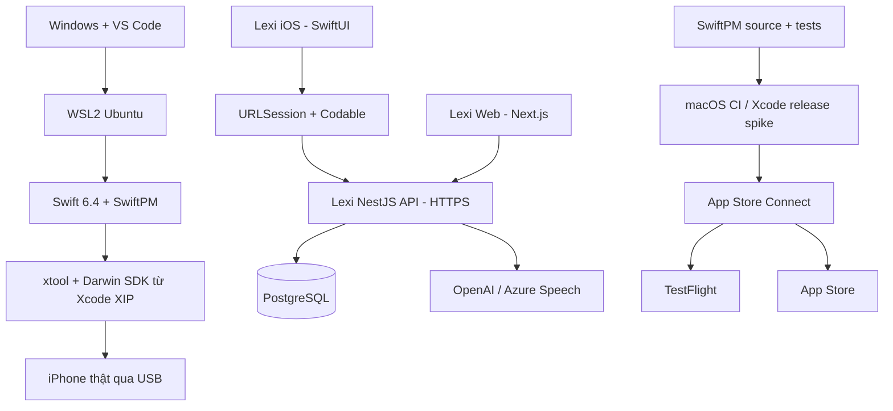
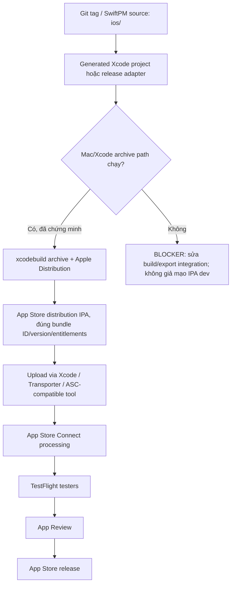

# LEXI iOS NATIVE — MASTER IMPLEMENTATION PLAN
## Swift 6 + SwiftUI + SwiftPM + xtool trên Windows/WSL2 → iPhone → TestFlight/App Store

> **Repository gốc:** https://github.com/XuanHuu2906/Lexi  
> **Repository công cụ:** https://github.com/xtool-org/xtool  
> **Ngày đối chiếu:** 17/10/2026  
> **Hệ điều hành phát triển:** Windows 10/11, WSL2 Ubuntu, VS Code Remote WSL  
> **Nền tảng sản phẩm:** **iOS native duy nhất**, ưu tiên iPhone; không phát triển Android  
> **Stack BẮT BUỘC:** **Swift / SwiftUI / Swift Package Manager / xtool** — **KHÔNG React Native, Expo, EAS**  
> **Backend MVP:** NestJS hiện có trong `backend/` + PostgreSQL, AI/ Azure tại server  
> **Backend Java:** `lexi-backend/` là chương trình chuyển đổi Spring Boot độc lập; không dùng thay NestJS trước khi đạt parity  
> **Đích phát hành:** build và cài trên **iPhone thật** bằng xtool; **TestFlight/App Store** qua quy trình distribution được xác minh riêng (ưu tiên macOS CI)  
> **Trạng thái:** **BẢN KẾ HOẠCH** — chưa tuyên bố Lexi SwiftUI đã biên dịch, chạy được, ký phân phối hoặc được App Store duyệt.  
> **Cách dùng:** Tick `[x]` khi có bằng chứng; mỗi task `IOS-...` là một issue/PR nhỏ; không bỏ qua các *exit gate*.

> **Cập nhật thực hiện Phase 0 — 17/10/2026:** Xem [báo cáo audit và trạng thái 35 task](ios-phase0-audit.md), [API contract](contracts/mobile-api.md) và [ADR](ios-decisions.md). Đã làm phần source/design, chưa đạt full exit gate. Người dùng có iPhone/cáp nhưng không có ADP và không thể dùng macOS/thuê máy: mục tiêu hiện tại là development trên iPhone; TestFlight/App Store **BLOCKED**. Dùng thư mục thực `iOS/` và `iOS/docs/` thay các đường dẫn `ios/`/root `docs/` đề xuất phía dưới. Các baseline source mới trong audit ưu tiên hơn mô tả cũ; không coi câu “đã xác minh” trong bản kế hoạch là bằng chứng runtime.

---

# 0. ĐỌC TRƯỚC KHI TRIỂN KHAI

## 0.1. Quyết định kiến trúc (đã chốt)

1. **Viết app iOS mới bằng SwiftUI native**, hoàn toàn không đóng gói website vào WebView và không dùng React Native.
2. **Dùng xtool làm công cụ build/sign/install trong môi trường phát triển Windows + WSL2.** Project iOS là SwiftPM package có `Package.swift`, `xtool.yml` và entry point `@main` của SwiftUI.
3. **Dùng chung API, tài khoản và cơ sở dữ liệu** với Lexi Web. Không nhân bản PostgreSQL, không gọi OpenAI/Azure trực tiếp từ iPhone, không chuyển thuật toán SRS sang client làm nguồn chân lý.
4. **Không sửa gãy web:** auth cookie + CSRF của website vẫn tồn tại; thêm auth dành cho native một cách có kiểm soát, dùng chung user và vòng đời session tại backend.
5. **Ưu tiên đạt “iPhone thật chạy được” ngay từ sớm** trước khi dựng đủ UI. Những phần đặc biệt: USB passthrough, code signing, Apple ID, SDK, native audio.
6. **Không đồng nhất `xtool dev build --sign --ipa` với IPA dùng để đưa lên App Store.** Chữ ký và provisioning để cài iPhone thử nghiệm khác với Apple Distribution/App Store distribution; phải chứng minh riêng quy trình lưu trữ, export, upload và Apple processing.
7. **Đường ra App Store:** thiết lập release spike sớm và hướng tới macOS CI/runner có Xcode phù hợp để tạo/kiểm tra bản phân phối, ký và upload theo hướng dẫn Apple. Nếu muốn App Store mà chỉ có Windows/WSL, đây là rủi ro trọng yếu cần giải quyết, không thể “đợi đến phase cuối”.
8. **Đích iOS khởi tạo:** iOS 17+ là lựa chọn ban đầu để đơn giản hóa SwiftUI và async/await; rà soát lại deployment target dựa vào thiết bị và yêu cầu Apple khi phát hành.
9. **Chốt nguồn mã:** `ios/` là package source-of-truth; file Xcode project do xtool sinh ra chỉ là **artifact phục vụ tích hợp macOS** cho đến khi release spike chứng minh có thể archive/distribute. Không chỉnh sửa thủ công các file sinh ra nếu không có cơ chế sinh lại ổn định.

## 0.2. Cảnh báo quan trọng nhất về xtool / Windows / App Store

- xtool tài liệu chính thức hỗ trợ Windows **qua WSL**, Swift toolchain Linux, Darwin Swift SDK trích xuất từ `Xcode.xip`, `usbmuxd`, USB passthrough và triển khai tới **iPhone vật lý**.
- Theo tài liệu xtool tại ngày đối chiếu: Linux/WSL dùng **Swift 6.4** và **Xcode 27 XIP**. Kiểm tra phiên bản ở tài liệu/release thực tế trước khi cài; ghim phiên bản đã xác minh và không dùng Swift/Xcode tùy ý.
- Trên Windows/WSL, **không có Xcode iOS Simulator cục bộ**. SwiftUI Preview của Xcode không được giả định hoạt động; thay bằng mock, unit test và iPhone thật; dùng macOS runner khi cần simulator/Xcode tooling.
- xtool có `xtool dev`, `xtool dev build`, `xtool dev build --sign --ipa`, `xtool dev generate-xcode-project`. Đây **không phải** cam kết rằng mọi SwiftUI/Xcode API, entitlements, extensions và mọi đường phát hành App Store đều tương thích.
- Apple Developer Program trả phí cần cho TestFlight và App Store. Tài khoản thường có thể dùng luồng đăng nhập xtool dựa trên private APIs nhưng **không phù hợp làm mặc định cho release**. Ưu tiên App Store Connect API key với tư cách/role hợp lệ khi sử dụng xtool và hệ thống phân phối.
- Tài liệu xtool nói bundle ID đôi khi có prefix `XTL-...` khi ký/cài lên thiết bị. **Bundle ID của App Store phải ổn định và trùng App ID đã đăng ký**. Đây là vấn đề phải kiểm chứng ngay trong release spike.
- App Store Connect công bố các cách upload như Xcode, Transporter, API. Upload **không** tự làm một IPA development thành IPA hợp lệ cho App Store. Không đặt câu lệnh upload cụ thể vào CI cho đến khi đã có distribution artifact hợp lệ và kiểm tra với Apple.

## 0.3. Định nghĩa “hoàn thành” theo cấp độ

| Cấp | Bằng chứng tối thiểu | Không được suy diễn |
|---|---|---|
| G0 — Môi trường | `swift --version`, `xtool --help`, `swift sdk list`, USB nhìn thấy iPhone | Không có nghĩa project Lexi build được |
| G1 — Device hello world | `xtool new` + `xtool dev` ký/cài/mở được app mẫu trên iPhone | Không có nghĩa IPA App Store hợp lệ |
| G2 — Lexi skeleton | SwiftUI Lexi build/launch bằng xtool, gọi health API | Chưa đủ authenticated production API |
| G3 — Secure session | Login, refresh, logout, account lock, CSRF regression có test | Chưa đủ chức năng học |
| G4 — MVP sync | Vocab/Review/Quiz hai chiều web ↔ iPhone, đầy đủ test | Chưa đủ release readiness |
| G5 — Native parity | AI, audio, offline/push theo scope, crash/perf đủ | Chưa có TestFlight mặc định |
| G6 — Distribution proven | Archive/export/sign phù hợp, upload accepted, TestFlight cài/mở | Chưa tự động được App Review duyệt |
| G7 — Release | App Review chấp thuận, rollout, monitoring và support | Không tự chứng minh retention/business success |

---

# 1. BASELINE ĐÃ KIỂM TRA TỪ REPOSITORY LEXI

## 1.1. Layout và công nghệ đang có

```text
Lexi/
├── frontend/             # Next.js 16, React 19, TypeScript, Tailwind, Zustand, React Query
│   └── src/
│       ├── app/(app)/    # dashboard, vocab, lookup, review, flashcards, quiz...
│       ├── lib/api/     # API client, types, mappers, modules
│       └── lib/speech.ts # browser Web Speech / WAV recording
├── backend/              # NestJS, Prisma 7, PostgreSQL, JWT/cookies/CSRF,
│   └── src/              # Words, review, quiz, AI, skills, progress, notifications
├── lexi-backend/         # Java 21 / Spring Boot — WIP, chưa parity các API
├── docs/
└── plans/
```

Các thành phần đã xác minh trong GitHub:

| Thành phần | Nguồn sự thật | Tác động tới iOS |
|---|---|---|
| Web proxy | `frontend/next.config.ts`: `/api/:path*` → backend `/:path*` | Native **không** dùng `http://localhost:3001/api` làm endpoint production; kết nối trực tiếp HTTPS public API hoặc ingress đã cấu hình |
| Web HTTP | `frontend/src/lib/api/client.ts`: cookie + CSRF + 401 refresh, `{success,data}` | Swift dùng `URLSession`, decoder response envelope, API error riêng |
| Đăng nhập | `backend/src/auth/auth.controller.ts`, `auth-cookies.ts` | Login web trả `{user,csrfToken}`, token nằm trong `Set-Cookie`, **chưa có JSON token native** |
| JWT | `backend/src/auth/strategies/jwt.strategy.ts` | Cookie được ưu tiên trước Bearer; Bearer fallback cho Swagger/test |
| CSRF | `backend/src/auth/guards/csrf.guard.ts` | Protected POST/PATCH/DELETE cần cookie + header CSRF. Native Bearer chưa thể gọi các route mutation “cứ thế là chạy” |
| Token rotation | `backend/src/auth/auth.service.ts` | Refresh token opaque, hash DB, rotate/reuse detection; phải chia sẻ service, không tạo auth hệ song song thiếu bảo vệ |
| Vocabulary | `frontend/src/lib/api/words.ts`, backend `words.controller.ts` | Các DTO, mapper và endpoint có thể mô phỏng bằng Swift Codable |
| SRS | `frontend/src/lib/api/review.ts`, backend `review.service.ts` | `forgot/hard/good/easy`, endpoint `/review/answer`, server quyết định nextReviewAt |
| Quiz | `frontend/src/lib/api/quiz.ts`, backend `review/quiz.controller.ts` | Generate, resume, save progress, submit |
| Audio | `frontend/src/lib/speech.ts`, backend `skills/pronunciation.controller.ts`, `azure-speech.service.ts` | Backend cần WAV PCM tương thích Azure; native AVFoundation phải kiểm tra/chuyển mã |
| Web Push | `backend/src/notification/push.service.ts`, `notification.controller.ts` | VAPID/browser subscription, **không** áp dụng trực tiếp cho APNs native |
| Thiết kế | `frontend/src/app/globals.css` | Màu `grape-500 #6C4BF5`, `cloud-100 #F4F2FB`, `ink-900 #1B1830`; đưa vào `DesignTokens.swift` |
| Spring backend | `lexi-backend/README.md` | Hiện chủ yếu foundation; không chuyển iOS sang API Java trước parity |

## 1.2. Những thứ phải giữ nguyên

- Một định danh user trong PostgreSQL; web và iOS đăng nhập cùng tài khoản.
- Không tự ý đổi DTO/contract của web chỉ vì native cần mô hình khác.
- Server bảo toàn dữ liệu user, lịch ôn, lịch sử quiz, streak, role và timezone.
- Duy trì khả năng **cookie auth + CSRF** trên web.
- Không đặt OpenAI/Azure API keys trong ứng dụng iOS hay `Info.plist`.
- Server xử lý permission: không dựa vào việc client ẩn tab admin để bảo vệ tài nguyên.
- Không bỏ logic SM-2 biến thể đang dùng. Theo tài liệu của chính Lexi: chu kỳ đầu `1 → 3`, cap interval = 21, ease trong `1.3..2.5`; lấy implementation thực tế làm chuẩn và thêm golden tests.
- Nếu có thay đổi backend sang Spring Boot, phải lập contract compatibility riêng và dual-client regression; **không gộp hai migration lớn trong MVP**.

## 1.3. Ghi chú về tái sử dụng mã

- SwiftUI không chạy được React components, TypeScript hooks hay CSS.
- Có thể **tái sử dụng ý nghĩa** các TypeScript DTO, mapper (viết lại Swift), lời văn, quy tắc UI, assets, thứ tự navigation và API.
- Tạo một `docs/contracts/mobile-api.md` có ví dụ JSON thực tế từ server; sau đó viết `Codable` và fixture/golden tests. Không hứa chia sẻ một source TypeScript trực tiếp với Swift.

---

# 2. KIẾN TRÚC ĐÍCH VÀ TECH STACK

## 2.1. Luồng tổng quát



**Hai luồng độc lập:**
1. Dev thường nhật: Windows → WSL → xtool → iPhone.  
2. Phân phối chính thức: cùng nguồn SwiftPM → **release pipeline đã xác minh** → Apple Developer/App Store Connect → TestFlight/App Store.

## 2.2. Stack được chốt và lý do

| Layer | Quyết định | Lý do / điều kiện |
|---|---|---|
| iOS framework | **SwiftUI** | Native, SwiftUI state-driven, phù hợp học iOS |
| Language | **Swift 6**, strict concurrency theo tính tương thích toolchain | Giảm data races, rõ actor boundaries |
| Package | **SwiftPM** | Đúng mô hình xtool; target/thư viện theo feature |
| Build/deploy dev | **xtool** | Theo đúng repository user chọn |
| IDE | **VS Code Remote WSL**, Swift extension, SourceKit-LSP | Edit Swift trong môi trường toolchain thực |
| Navigation | `NavigationStack`, `TabView`, route enum | Không thêm router bên thứ ba ngay |
| ViewModel | `@Observable` (nếu toolchain/deployment hỗ trợ) hoặc `ObservableObject` | MVVM nhẹ, dễ test; không bắt buộc ViewModel cho view đơn giản |
| DI | Protocol-based injection + composition root | Fakes/mocks; không cần framework DI ngay |
| HTTP | `URLSession` + `async/await` + `Codable` | Foundation native, testability |
| Authentication | Bearer JWT; opaque refresh in Keychain | Không phá cookie auth của web |
| Persistence | `Keychain` secrets; `SwiftData`/SQLite **sau spike** | Không chọn DB offline trước khi rõ sync strategy |
| Audio | `AVFoundation`, `Speech` khi phù hợp | Native audio; backend Azure vẫn chấm phát âm |
| TTS | `AVSpeechSynthesizer` | Không lệ thuộc browser SpeechSynthesis |
| Notifications | `UserNotifications` local first; APNs remote later | Nhắc học trên iPhone, tách khỏi Web Push |
| Background | Apple approved background APIs chỉ khi cần | Không giả định app luôn chạy nền |
| Diagnostics | `Logger`/OSLog, crash monitoring khi release | Tránh log dữ liệu học nhạy cảm/token |
| Distribution | Apple signing + TestFlight; macOS runner fallback | Có gate kiểm chứng, không quảng cáo xtool hoàn tất mọi bước |

## 2.3. Bố trí repo (khuyến nghị)

```text
Lexi/
├── frontend/                       # Next.js — không sửa UI web vì iOS
├── backend/                        # NestJS — bổ sung native auth, push API sau
├── lexi-backend/                   # Spring Boot WIP — giữ độc lập
├── ios/                            # NEW: nguồn iOS native
│   ├── Package.swift
│   ├── Package.resolved
│   ├── xtool.yml
│   ├── Resources/
│   │   ├── AppIcon.png
│   │   ├── Info.plist
│   │   └── Lexi.entitlements          # Chỉ khi cần, capability đã duyệt
│   ├── Sources/
│   │   ├── LexiApp/                   # @main, TabView, composition root
│   │   ├── LexiCore/                  # APIClient, auth, typed errors
│   │   ├── LexiDesign/                # Colors, typography, reusable views
│   │   ├── LexiFeatures/
│   │   │   ├── Authentication/
│   │   │   ├── Dashboard/
│   │   │   ├── Vocabulary/
│   │   │   ├── Review/
│   │   │   ├── Flashcards/
│   │   │   ├── Quiz/
│   │   │   ├── AI/
│   │   │   ├── Speech/
│   │   │   ├── Notifications/
│   │   │   └── Settings/
│   │   └── LexiDomain/                # DTOs, domain, mappers
│   ├── Tests/
│   │   ├── LexiCoreTests/
│   │   ├── LexiDomainTests/
│   │   └── LexiFeatureTests/
│   ├── scripts/
│   │   ├── check-env.sh
│   │   ├── smoke-api.sh
│   │   └── verify-bundle.sh
│   └── README.md
├── docs/
│   ├── LEXI_IOS_MASTER_IMPLEMENTATION_PLAN.md
│   ├── contracts/mobile-api.md
│   ├── ios-decisions.md
│   └── ios-release-spike.md
└── .github/workflows/
    ├── ios-swift-check.yml            # Linux build/test khả thi sau spike
    └── ios-release-macos.yml          # Chỉ bật khi archive flow đã chứng minh
```

**Lưu ý:** `xtool new LexiIOS` sẽ tạo cấu trúc SwiftPM tối thiểu. **Giữ template xtool làm baseline**, không áp nguyên cấu trúc nhiều target ở trên ngay nếu khiến xtool planner không nhận app. Chia module từ từ sau khi device smoke pass.

## 2.4. Chiến lược môi trường

| Env | URL | Database | Apple signing | Dùng cho |
|---|---|---|---|---|
| Local | `http://...` chỉ trong LAN/dev tạm; ưu tiên HTTPS tunnel | DB dev | Apple Development / device | Smoke, không commit URL/secrets |
| Staging | `https://api-staging.<domain>` | DB staging riêng | Development/Ad Hoc/TestFlight tùy pipeline | Integration, TestFlight |
| Production | `https://api.<domain>` | DB production | Apple Distribution cho release | App Store |

- Không dùng `localhost` trên iPhone để gọi backend Windows; `localhost` của iPhone là chính iPhone.
- Kiểm chứng HTTPS/TLS từ iPhone; không tắt ATS toàn cục để “chữa” lỗi local API.
- Đưa base URL bằng cấu hình build môi trường; **API keys bí mật nằm ở server**, không coi chuỗi nhúng trong app là bí mật.
- Tách user test và dataset staging, không dùng tài khoản người dùng thật cho screenshot/dev logs.

---

# 3. ROADMAP, PHỤ THUỘC VÀ GATES

| Phase | Tên | Phụ thuộc | Kết quả trọng tâm | Exit gate |
|---|---|---|---|---|
| 0 | Contract, ADR, release feasibility | Không | Baseline API, đường ra App Store thực tế | G0-design |
| 1 | Windows/WSL + toolchain + iPhone | 0 | xtool hello world trên thiết bị | G1 |
| 2 | Lexi SwiftPM skeleton + network | 1 | Lexi SwiftUI mở và gọi health | G2 |
| 3 | Domain models + API transport | 2 | Codable, errors, fixture tests | G2-contract |
| 4 | Native authentication + security | 3 | Login / refresh / logout an toàn | G3 |
| 5 | Design system + app shell | 3,4 | UI nhận diện Lexi + navigation | G3-UI |
| 6 | Vocabulary + Dashboard + Settings | 4,5 | Dữ liệu thật, CRUD, stats | G4-part 1 |
| 7 | SRS + Flashcards + Quiz | 6 | MVP học từ vựng đồng bộ web | G4-MVP |
| 8 | AI text + conversation | 7 | Tutor, Grammar, Writing, chat | G5-part 1 |
| 9 | Audio native + Azure | 8 hoặc sau 7 | Speech, pronunciation, dictation | G5-part 2 |
| 10 | Notifications + offline strategy | 7; 9 nếu push/audio | Nhắc học, cache, sync an toàn | G5-part 3 |
| 11 | QA, security, privacy, accessibility | 7–10 | release candidate có kiểm chứng | G5-RC |
| 12 | Distribution, TestFlight, App Store | 0 release spike + 11 | Bản phát hành thực tế | G6/G7 |
| 13 | Maintenance, Spring Boot cutover (optional) | 12 | Vận hành và cải tiến | G8 |

**Nhánh chạy song song bắt buộc:** *Distribution feasibility spike* bắt đầu tại **Phase 0**, không chờ tới Phase 12; nếu cần macOS runner, phải quyết định/chuẩn bị ngay khi hello world hoàn thành.  
**MVP đề nghị:** Phase 0–7 + yêu cầu bảo mật tối thiểu ở Phase 11 + đường TestFlight của Phase 12. AI/audio/push có thể release theo vòng sau nếu chưa an toàn/ổn định.  
**Giới hạn khối lượng:** Các ước lượng Sprint chỉ là kế hoạch cho người triển khai, không phải cam kết hoàn thành; ưu tiên exit gate và chức năng hoạt động hơn ngày tháng.

### Gate bắt buộc, không thương lượng

- **G0:** `/ios` không đụng vào website, API contracts đo được, bản kế hoạch App Store release có chủ sở hữu.
- **G1:** có video/log cài app SwiftUI mẫu trên iPhone thật từ Windows/WSL qua xtool.
- **G2:** Lexi SwiftUI gọi được staging API trên iPhone thật; không dùng hardcoded credential.
- **G3:** login cùng account web, refresh/reuse detection, logout và CSRF regressions pass.
- **G4:** same-word/same-user data sau hành động trên một client xuất hiện đúng ở client kia; review không double-submit.
- **G5:** privacy, auth, crashes, audio/permissions, data loss, accessibility đủ chất lượng tối thiểu.
- **G6:** Apple nhận build TestFlight đã ký đúng; số version/build và bundle ID chính xác; testers cài và mở được.
- **G7:** App Review approve; có chính sách hỗ trợ và xử lý sự cố.

---
# PHASE 0 — AUDIT REPO, KHÓA API CONTRACT VÀ CHỨNG MINH ĐƯỜNG APP STORE

**Mục tiêu:** Bắt đầu đúng từ trạng thái Lexi thực tế; định nghĩa bản iOS cần gì và làm cách nào đưa bản SwiftPM/xtool tới App Store.  
**Không viết nhiều Swift ở phase này.**  
**Input:** repository `XuanHuu2906/Lexi`, repo `xtool-org/xtool`, một iPhone thực tế, khả năng đăng ký Apple Developer Program.  
**Output:** contract matrix, ADR, risk register, release spike plan, scope MVP.

## 0.A. Rà soát hiện trạng

- [x] **IOS-0001** Clone `Lexi` tại một commit/branch xác định; ghi SHA, ngày và môi trường.
- [x] **IOS-0002** Kiểm kê `backend/src/**/*.controller.ts`; ghi method, path, public/protected, DTO, status, errors, side effects.
- [ ] **IOS-0003** Kiểm kê `frontend/src/lib/api/*.ts`; lấy request/response JSON thực (đã ẩn thông tin nhạy cảm) cho các API iOS dùng.
- [ ] **IOS-0004** Xác nhận backend chạy ở port/env nào, prod API có HTTPS domain chưa; đừng dùng `localhost` trên iPhone.
- [ ] **IOS-0005** Xác nhận DB staging/dev riêng, seed user test, word fixtures, mock AI.
- [x] **IOS-0006** Ghi lại semantic của `ApiSuccess<T>` và `ApiErrorBody`; response `204` có body hay không.
- [x] **IOS-0007** Ghi rõ pagination `page/limit`, sorting, search, filtering, empty/error cases.
- [x] **IOS-0008** Đọc/đóng băng SRS variant, timezone và cách tính `due`, `streak`, `lastActiveDate`.
- [x] **IOS-0009** Lập danh sách AI endpoints (chi phí, rate limit, timeout, quota, retry policy).
- [x] **IOS-0010** Lập ma trận mobile capabilities cần thiết: microphone, speech, TTS, notifications, network, Keychain, background modes.
- [x] **IOS-0011** Đánh dấu feature admin là *out of scope* cho Learner iOS MVP trừ khi có yêu cầu riêng.
- [ ] **IOS-0012** Chốt iOS minimum version/tập iPhone target (ví dụ iOS 17+, cần số liệu người dùng để chốt lâu dài).

## 0.B. Rà soát native auth và an ninh

- [x] **IOS-0013** Ghi lại `access_token`, `refresh_token`, `csrf_token`, cookie paths và expiry theo code thực.
- [x] **IOS-0014** Ghi cụ thể thứ tự extractor: cookie **trước** Bearer ở NestJS JWT Strategy.
- [x] **IOS-0015** Đánh giá CSRF guard: mutating endpoints yêu cầu cookie `csrf_token` + header; native chỉ Bearer hiện không pass.
- [x] **IOS-0016** Thiết kế native session REST contract; không tự ý dùng lại `POST /auth/login` mà mong nhận raw token trong JSON.
- [ ] **IOS-0017** Thiết kế token storage/refresh rotation; kiểm thử 401 concurrency và reused refresh token.
- [x] **IOS-0018** Chốt quy tắc tách cookie/Bearer **theo cơ chế auth thực được chọn**, không bỏ CSRF chỉ vì request *có* header Authorization (nguy cơ bypass khi cookie vẫn được ưu tiên).
- [x] **IOS-0019** Kiểm tra các flow cần App Store guideline: account deletion, privacy, AI content, user support, login test account.

## 0.C. Feasibility spike App Store — thực hiện sớm

- [ ] **IOS-0020** Đọc `xtool` release notes/installation đúng phiên bản trên WSL; pin phiên bản xtool, Swift 6.4, Xcode 27 XIP phù hợp.
- [ ] **IOS-0021** Chọn bundle ID ổn định, ví dụ `com.<your-domain>.lexi` **sau khi xác nhận quyền sở hữu**; không dùng `com.example` để release.
- [ ] **IOS-0022** Xác định Apple Developer Program Team ID, Certificates/Identifiers/Profiles, và các role hợp lệ.
- [ ] **IOS-0023** Dự kiến cách archive/sign/export distribution: kiểm chứng `xtool dev generate-xcode-project` có thể được Xcode/macOS CI tiếp nhận hay không; nếu không, cần adapter/packaging path khác được chứng minh.
- [ ] **IOS-0024** Viết `docs/ios-release-spike.md`: build source, exact commands, expected outputs, chứng chỉ, provisioning, tiêu chí App Store Connect processing.
- [ ] **IOS-0025** Rà lại việc xtool có thể prefix `XTL-*` lên bundle ID khi device signing; tách dev signing và distribution signing theo bundle ID cố định.
- [ ] **IOS-0026** Quyết định nguồn macOS runner (GitHub Actions macOS, máy Mac thuê/CI hoặc dịch vụ macOS build tương thích); không giả định runner miễn phí hay có thể dùng vô hạn.
- [x] **IOS-0027** Lập công việc upload qua Xcode / Transporter / App Store Connect API theo quy trình Apple, không sử dụng IPA dev-sign trực tiếp.
- [x] **IOS-0028** Mở blocker/risk đỏ nếu chưa tìm được đường phân phối có bằng chứng và chủ sở hữu.

## 0.D. Scope và tài liệu

- [x] **IOS-0029** Chốt MVP: Auth, Dashboard, Vocabulary/Lookup, SRS Review, Flashcards, Quiz, Settings, sync web↔iOS.
- [x] **IOS-0030** Chốt V1.1: Grammar, AI Tutor, Writing, Conversation, Pronunciation/Dictation (có thể tách release).
- [x] **IOS-0031** Chốt V1.2: offline thông minh, local/APNs notification, telemetry/analytics tùy privacy.
- [x] **IOS-0032** Viết ADR-001 SwiftUI+xtool, ADR-002 native auth, ADR-003 API as source of truth, ADR-004 release macOS CI contingency.
- [ ] **IOS-0033** Chuẩn bị test account seed và JSON fixtures sạch: user, word, due, quiz, 401, 403, 429, 500.
- [x] **IOS-0034** Đề xuất GitHub labels: `ios`, `phase:0` ... `phase:13`, `backend`, `security`, `blocking`, `release`, `testing`.
- [x] **IOS-0035** Dựng dependency graph cho issues; task bị block phải trỏ issue chặn.

**Deliverables:** `docs/contracts/mobile-api.md`, `docs/ios-decisions.md`, `docs/ios-release-spike.md`, `docs/ios-risk-register.md`, fixture sanitized.  
**Tests:** review/approval contract từ code; smoke backend `/health`; ma trận cookie vs Bearer scenarios.  
**Exit gate:** Không còn hiểu lầm xtool là tự động upload App Store; mobile auth spec được review, release pipeline có quyết định kỹ thuật cụ thể.

---

# PHASE 1 — WINDOWS + WSL2 + SWIFT/SDK + XTOOL + IPHONE THẬT

> **Cập nhật 18/10/2026:** **G1 đạt theo xác nhận của người dùng**: đã cài HelloLexi lên iPhone và mở thấy “Hello, World”. Kết nối WSL đã kiểm tra trực tiếp (`iPhone14,8`, iOS `26.7.1`). Chưa lưu screenshot/video hoặc log signing; xem [runbook thiết bị](ios-windows-device.md). Không đồng nghĩa mọi task Phase 1 hoặc G2 đã hoàn tất.

**Mục tiêu:** Chạy **ứng dụng SwiftUI mẫu trên iPhone bằng xtool**, từ Windows. Chưa viết UI Lexi.  
**Ưu tiên P0:** nếu bước này thất bại, **không** xây hàng chục màn hình SwiftUI rồi mới phát hiện không deploy được.

## 1.A. Windows và WSL

- [ ] **IOS-0101** Xác nhận Windows có hỗ trợ WSL2 và virtualization/CPU RAM/SSD đủ dùng; ưu tiên ổ đĩa trống lớn cho Xcode XIP và SDK.
- [ ] **IOS-0102** Cài WSL theo Microsoft (PowerShell Administrator): `wsl --install -d Ubuntu` rồi restart nếu được yêu cầu.
- [ ] **IOS-0103** Kiểm tra `wsl --status`, `wsl -l -v`, Ubuntu đang ở WSL version 2.
- [ ] **IOS-0104** Cài VS Code và **Remote - WSL**, mở terminal WSL trực tiếp.
- [ ] **IOS-0105** Đặt workspace project ở filesystem Linux (`~/projects/Lexi`), không đặt build scratch ở `/mnt/c/...` vì hiệu năng/file permission.
- [ ] **IOS-0106** Cài git, curl, unzip và các gói hệ thống do Swift/xtool hướng dẫn; **không** cài mọi package từ blog ngẫu nhiên.
- [ ] **IOS-0107** Kiểm tra `uname -m`; AppImage xtool tải về phải khớp kiến trúc WSL.

## 1.B. Swift + xtool

- [ ] **IOS-0108** Cài Swift **6.4** phù hợp Ubuntu theo `https://swift.org/install/linux` (Swiftly/toolchain installer nếu áp dụng).
- [ ] **IOS-0109** Chạy `swift --version`; lưu stdout để chặn sai toolchain.
- [ ] **IOS-0110** Cài `usbmuxd` và `libimobiledevice-utils` (`sudo apt-get install usbmuxd libimobiledevice-utils`).
- [ ] **IOS-0111** Tải release `xtool` từ trang GitHub chính thức, kiểm tra asset/version, đặt vào PATH và `chmod +x`.
- [ ] **IOS-0112** Chạy `xtool --help`; nếu AppImage báo thiếu runtime/FUSE, xử lý theo tài liệu AppImage/Linux thay vì đổi tool.
- [ ] **IOS-0113** Download **Xcode 27 `.xip`** từ Apple Developer Downloads, đăng nhập Apple ID và chấp nhận license.
- [ ] **IOS-0114** Xác nhận vị trí file XIP có thể truy cập từ WSL (ví dụ `/mnt/c/Users/.../Downloads/...xip`); đảm bảo đủ disk trong Linux khi xtool trích SDK.
- [ ] **IOS-0115** Chạy `xtool setup`: đăng nhập Apple (API key nếu có membership), cung cấp đường dẫn Xcode XIP.
- [ ] **IOS-0116** Chạy `swift sdk list` và `xtool sdk status`; Darwin SDK xuất hiện và có thể dùng.
- [ ] **IOS-0117** Lưu phiên bản vào `ios/README.md` và `docs/ios-toolchain-versions.md`.

## 1.C. Windows USB → WSL → iPhone

- [ ] **IOS-0118** Trên Windows cài USBIPD theo hướng dẫn Microsoft `https://learn.microsoft.com/en-us/windows/wsl/connect-usb`.
- [ ] **IOS-0119** Cắm iPhone cáp hỗ trợ dữ liệu, mở khóa, chọn **Trust This Computer** khi iOS hỏi.
- [ ] **IOS-0120** Liệt kê USB devices bằng `usbipd list` từ PowerShell; chọn **đúng busid** của iPhone, không chép busid ví dụ máy khác.
- [ ] **IOS-0121** Bind/attach USB vào WSL theo cú pháp phiên bản usbipd-win đang dùng; ghi lệnh đã hoạt động vào `docs/ios-windows-device.md`.
- [ ] **IOS-0122** Trong WSL chạy `lsusb`, `ideviceinfo` và `xtool devices`; xác nhận thiết bị thấy được/pair.
- [ ] **IOS-0123** Nếu lỗi mux/usbmuxd: kiểm tra daemon/service, trạng thái cặp thiết bị, quyền truy cập USB, restart và issue xtool về AFCClient.muxError.
- [ ] **IOS-0124** Bật **Developer Mode** trên iPhone (nếu iOS yêu cầu), hoàn thành pairing/trust developer theo hướng dẫn Apple.

## 1.D. Smoke mẫu chính thức xtool

- [ ] **IOS-0125** Trong workspace trống: `xtool new HelloLexi`.
- [ ] **IOS-0126** Vào thư mục `HelloLexi`; đọc `Package.swift`, `xtool.yml` và app `@main` được tạo.
- [x] **IOS-0127** Chạy `xtool dev`; phải thấy build, ký, cài trên **iPhone thực tế**. Người dùng xác nhận đã cài HelloLexi; không thu thập lại log signing trong phiên này.
- [x] **IOS-0128** Mở app mẫu trên iPhone, thấy màn hình SwiftUI; lưu screenshot/changelog. Người dùng xác nhận thấy “Hello, World”; changelog ghi trong runbook thiết bị, chưa có screenshot.
- [ ] **IOS-0129** Sửa một `Text`, build + reinstall, xác nhận thay đổi xuất hiện.
- [ ] **IOS-0130** Kiểm tra `xtool dev build`; xác nhận `.app` được xuất ở vị trí thực, không hardcode path chưa đo.
- [ ] **IOS-0131** Kiểm tra `xtool dev build --sign --ipa` trong môi trường dev, ghi rõ signing identity và bundle ID thực của IPA.
- [ ] **IOS-0132** Chạy `xtool dev generate-xcode-project`; lưu artifact và log để phục vụ Phase 0 distribution spike.
- [ ] **IOS-0133** Viết `scripts/check-env.sh` để check swift, xtool, sdk, usbmuxd (không kiểm tra login secret bằng cách in ra console).
- [ ] **IOS-0134** Viết troubleshooting cụ thể: usbipd device reconnect, Swift SDK mismatch, missing Info.plist keys, signing/trust failure.

### Command tham khảo (phải đối chiếu với phiên bản tool trước khi chạy)

**PowerShell (Admin, phần cài WSL):**

```powershell
wsl --install -d Ubuntu
wsl --status
wsl -l -v
# Cài usbipd-win theo tài liệu Microsoft, sau đó:
usbipd list
# usbipd bind --busid <BUS_ID> (Administrator, chỉ sau khi xác nhận thiết bị)
# usbipd attach --wsl --busid <BUS_ID> (theo phiên bản usbipd hiện tại)
```

**WSL Ubuntu (toolchain và hello world):**

```bash
sudo apt-get update
sudo apt-get install -y usbmuxd libimobiledevice-utils curl git
swift --version                     # mục tiêu phù hợp docs: Swift 6.4
# tải xtool theo release chính thức, kiểm tra tên asset trước
curl -fL "https://github.com/xtool-org/xtool/releases/latest/download/xtool-$(uname -m).AppImage" -o xtool
chmod +x xtool
sudo mv xtool /usr/local/bin/
xtool --help
xtool setup                         # Apple credentials + Xcode 27 XIP path
swift sdk list                     # 'darwin'
xtool devices                      # iPhone connected
xtool new HelloLexi
cd HelloLexi
xtool dev                          # build + sign + install to iPhone
xtool dev build                    # build only
xtool dev generate-xcode-project   # release feasibility artifact
```

**Deliverables:** `docs/ios-windows-device.md`, toolchain lock, video/screenshot app iPhone, diagnostics logs sanitized.  
**Tests:** disconnect/reconnect USB; cold build; edit/redeploy; system restart and reproduce.  
**Exit gate G1:** Có app mẫu build/cài/mở trên iPhone với xtool từ WSL. Không lấy “Swift code compile Linux” thay cho gate này.

---

# PHASE 2 — LEXI SWIFTPM APP SKELETON + NETWORK SMOKE

> **Cập nhật 18/10/2026:** Đã triển khai source trong `iOS/`, unit tests core và build iOS bằng xtool thành công. Xem [báo cáo Phase 2](ios-phase2-status.md). Chưa đạt G2: chưa có staging HTTPS (người dùng xác nhận), WSL chưa nhận iPhone ở phiên kiểm tra này.

**Mục tiêu:** Thay app mẫu bằng `LexiIOS` SwiftUI, có module cấu trúc vừa đủ, thể hiện brand và lấy dữ liệu thật từ backend qua `URLSession`.

## 2.A. Tạo SwiftPM đúng xtool

- [x] **IOS-0201** Thêm thư mục `ios/` vào repository Lexi; tạo từ `xtool new LexiIOS`, di chuyển/copy template vào đúng cấu trúc.
- [x] **IOS-0202** Đảm bảo `Package.swift` mô tả product/target mà xtool planner nhận, Swift tools/version khớp; không tự thay bằng Xcode project làm source.
- [x] **IOS-0203** Tạo `xtool.yml` schema v1; bundle ID dev hợp lệ; `product` nếu app product không suy ra được.
- [x] **IOS-0204** Tạo `LexiIOSApp` `@main`, root `WindowGroup` và `WelcomeView` đơn giản.
- [x] **IOS-0205** Tạo `Resources/AppIcon.png` (PNG 1024×1024); `iconPath` trong `xtool.yml`.
- [x] **IOS-0206** Tạo `Resources/Info.plist`; nối `infoPath` trong `xtool.yml`; chưa xin quyền mic/push nếu chưa dùng.
- [x] **IOS-0207** Tạo `AppEnvironment` với `apiBaseURL`, build flavor; tránh secret trong binary.
- [x] **IOS-0208** Tạo `AppContainer` / dependency injection đơn giản.
- [x] **IOS-0209** Tạo placeholder views: Launch, Login, Dashboard, Error, Offline; không đầu tư pixel-perfect.
- [ ] **IOS-0210** Build `xtool dev build` và `xtool dev` lên iPhone; tối ưu sau, chưa chia nhiều SwiftPM target nếu build chưa ổn.

## 2.B. HTTP smoke và testability

- [x] **IOS-0211** Tạo `HTTPTransport` protocol có `send(_:) async throws -> (Data, HTTPURLResponse)`.
- [x] **IOS-0212** Implement URLSession transport có timeout, cancellation, ATS-compliant HTTPS.
- [x] **IOS-0213** Gọi endpoint health không cần auth, decode response `{success,data}` theo schema thật. Code + fixture test pass; live endpoint chờ IOS-0216.
- [x] **IOS-0214** UI hiện `API reachable` / `Network unavailable` dựa vào result thực, không hardcode success.
- [ ] **IOS-0215** Test airplane mode và timeout; hiển thị retry UX, không crash.
- [ ] **IOS-0216** Kiểm tra trên iPhone thật khi backend ở staging HTTPS; không dùng localhost URL.
- [x] **IOS-0217** `README.md` mô tả chạy SwiftPM `swift test`, build xtool, cấu hình base URL, pairing device và nơi tìm log.
- [x] **IOS-0218** `.gitignore` cho `.build/`, `xtool/`, generated Xcode project nếu là artifact, key/certs/profiles và file env chứa thông tin nhạy cảm.

### File cấu hình `xtool.yml` minh họa

```yaml
version: 1
bundleID: com.example.LexiIOS # THAY bằng ID đã đăng ký trước khi distribution
iconPath: Resources/AppIcon.png
infoPath: Resources/Info.plist
```

### SwiftUI root ví dụ (ý tưởng tối thiểu, xác nhận với package template đã tạo)

```swift
import SwiftUI

@main
struct LexiIOSApp: App {
    var body: some Scene {
        WindowGroup {
            Text("Lexi")
                .font(.largeTitle.bold())
                .foregroundStyle(.purple)
        }
    }
}
```

**Deliverables:** `ios/Package.swift`, `xtool.yml`, SwiftUI app, HTTP health client.  
**Exit gate G2:** Có thể clone repo trên WSL sạch, build Lexi iOS và gọi API health trên iPhone thực; giao diện phản hồi thành công/thất bại trung thực.

---

# PHASE 3 — DOMAIN MODELS, URLSESSION CLIENT, CONTRACT TESTS

**Mục tiêu:** Layer dữ liệu type-safe, dễ kiểm thử, không phụ thuộc trực tiếp SwiftUI. Mọi feature về sau **chỉ** gọi `LexiAPI`, không rải `URLSession.shared` trong View.

> **Cập nhật 18/10/2026:** 30/30 task Phase 3 hoàn tất theo phạm vi data layer/client; 38 Swift tests, xtool build và full staging smoke (5 GET, có Bearer cho protected routes) PASS. Exit gate Phase 3 đạt. Auth mobile chỉ có client cho contract đề xuất, backend/session thuộc Phase 4. Chi tiết: [báo cáo Phase 3](ios-phase3-status.md) và [bằng chứng staging](evidence/phase3-staging-smoke-2026-10-18.md).

## 3.A. Domain và DTO

- [x] **IOS-0301** Tạo `APIEnvelope<T: Decodable>` có `success` và `data` (theo response server).
- [x] **IOS-0302** Tạo `APIErrorPayload` cho `statusCode`, `message` (string hoặc string[]), `error`, `path`, `timestamp`.
- [x] **IOS-0303** Tạo `HTTPError` typed: network, timeout, unauthorized, forbidden, rateLimit, validation, server, decoding, cancellation.
- [x] **IOS-0304** Tạo `BackendWordDTO`: `term`, `meaning`, `partOfSpeech`, `status`, `srsData.nextReviewAt`, etc.
- [x] **IOS-0305** Tạo `Word` domain Swift: `id`, `word`, `meaning`, `phonetic`, `pos`, `status`, `topic`, `examples`, `nextReviewAt`.
- [x] **IOS-0306** Port **mapper hành vi**, không copy TypeScript syntax: `NEW→new`, `LEARNING→due`, `MASTERED→learned`.
- [x] **IOS-0307** Tạo `WordInputDTO` mapping `word→term`, `pos→partOfSpeech`; golden test hai chiều.
- [x] **IOS-0308** Tạo models `ApiMe`, `Settings`, `Streak`, `Stats`, `Paginated<T>`.
- [x] **IOS-0309** Tạo models `DueReviews`, `ReviewRating`, `ReviewAnswerResult`, `FlashcardSet`, `QuizState/QuizResult`.
- [x] **IOS-0310** Tạo AI result models `TutorResult`, `WritingResult`, `GrammarQaResult`, `PronunciationResult`; chỉ implement fields thực sự cần.
- [x] **IOS-0311** Chốt ISO-8601 server timezone (`Z`, offsets, fractional seconds). Đọc raw strings an toàn và decode date tập trung, test nhiều biến thể trước khi dùng `Date`.
- [x] **IOS-0312** Phân biệt null/missing/empty string; không tự chuyển nil thành placeholder làm sai data.

## 3.B. API client

- [x] **IOS-0313** Tạo `APIEndpoint` với path, method, query, headers, body encoder, requiresAuth.
- [x] **IOS-0314** Tạo URL joining an toàn; chặn slash kép/path encoding sai, encode path segments như word ID.
- [x] **IOS-0315** Có JSONEncoder/Decoder thống nhất camelCase đúng contract NestJS.
- [x] **IOS-0316** Có per-request cancellation theo Swift concurrency để search debouncing hoạt động.
- [x] **IOS-0317** Timeout theo nhóm: read nhanh, AI dài, upload audio; không nâng vô hạn.
- [x] **IOS-0318** 429 hiển thị cooldown/quota thay vì retry liên tục; honor `Retry-After` nếu backend trả.
- [x] **IOS-0319** Chỉ retry request idempotent, lỗi mạng tạm thời; **không tự retry POST** `/review/answer`, `/quiz/submit`, AI fee-heavy operations khi chưa có idempotency semantics.
- [x] **IOS-0320** Request-ID (`X-Request-ID`) cho tracing nếu backend hỗ trợ; không log JWT, cookies, transcription hay response private.
- [x] **IOS-0321** `APIClient` inject `HTTPTransport`, `TokenProvider`, `Clock`/sleeper (nếu cần tests).
- [x] **IOS-0322** Tạo mock transport để test request headers, path, status, JSON decoding, concurrency.
- [x] **IOS-0323** Tạo `AuthAPI`, `WordsAPI`, `ReviewAPI`, `QuizAPI`, `StatsAPI`, `SettingsAPI` theo endpoints trong ma trận cuối file.
- [x] **IOS-0324** Tạo API contract fixtures đúng shape NestJS; test `200/201/204`, `401/403/404/409/422/429/5xx`, malformed JSON.
- [x] **IOS-0325** Tạo API smoke script `scripts/smoke-api.sh` trên staging có token test qua env, không hardcode.

## 3.C. Code quality

- [x] **IOS-0326** Bật Swift concurrency checks theo cấu hình tương thích xtool/Swift 6; giải quyết `Sendable`/actor isolation đúng cách.
- [x] **IOS-0327** Chốt quy tắc `@MainActor` cho UI ViewModel, actor cho token/session coordination.
- [x] **IOS-0328** Không force unwrap / `try!` ở API paths, không silent catch làm mất lỗi.
- [x] **IOS-0329** Tách `Domain`, `Infrastructure`, `Features`, `App` chỉ khi xtool tiếp tục build multi-target pass.
- [x] **IOS-0330** Ghim package dependencies; tránh thêm Alamofire/RxSwift trước khi thật sự cần.

**Deliverables:** Swift domain models, request/response mappers, URLSession-based APIClient, test fixtures.  
**Exit gate:** Các fixture critical decode/pass; Swift compiler không có lỗi concurrency mới; app gọi API không dựa trên direct fetch ở View.

---
# PHASE 4 — NATIVE AUTHENTICATION, KEYCHAIN, TOKEN ROTATION, CSRF REGRESSION

**Mục tiêu:** SwiftUI login dùng chung user với Lexi Web **mà không phá kiến trúc bảo mật cookie của Next.js**. Đây là phase backend + iOS quan trọng nhất.

## 4.A. Vấn đề được chứng minh từ repo

**Baseline trước Phase 4 (lịch sử; trạng thái đã triển khai nằm ở 4.C):**

1. `POST /auth/login` trả `{user,csrfToken}`; actual tokens được đặt trong cookies `httpOnly`.
2. Access JWT được đọc từ cookie trước, Bearer fallback nếu cookie vắng mặt.
3. Refresh token opaque random; chỉ hash lưu trong DB; server rotate/revoke/reuse detection.
4. `CsrfGuard` yêu cầu matching cookie `csrf_token` + `X-CSRF-Token` cho protected mutating methods, dù route có JWT Bearer.
5. Cookie refresh path `/api/auth` phản ánh địa chỉ frontend proxy, **không** phải endpoint native public.

Vì vậy **không** nên: hardcode `Set-Cookie`, dùng `WKWebView` login như mẹo vặt, tắt CSRF global, hoặc thêm JWT token vào JSON response của web login một cách vô điều kiện.

## 4.B. Native REST contract (đã triển khai; account deletion ngoài phạm vi)

| Method | Endpoint đề xuất | Request | Response data đề xuất | Auth |
|---|---|---|---|---|
| `POST` | `/auth/mobile/register` | `{email,password}` | `{user,accessToken,refreshToken,accessExpiresIn}` | Public + throttle |
| `POST` | `/auth/mobile/login` | `{email,password}` | `{user,accessToken,refreshToken,accessExpiresIn}` | Public + throttle |
| `POST` | `/auth/mobile/refresh` | `{refreshToken}` | `{accessToken,refreshToken,accessExpiresIn}` | Public nhưng token validated + throttle |
| `POST` | `/auth/mobile/logout` | `{refreshToken}` | `{message}` | Auth/session-aware, revocation required |
| `GET` | `/users/me` | Bearer `Authorization` | `ApiMe` hiện tại | Protected |
| `DELETE` | `/users/me` **nếu bổ sung** | authenticated + explicit confirmation | account deletion status | Protected, review semantics |

**Cập nhật 18/10/2026:** bốn endpoint `mobile/*` đã triển khai qua PR #12 và xác minh có trên staging. Response chung giữ `{success:true,data:...}`; native dùng Bearer và JSON token, web giữ cookie. `DELETE /users/me` vẫn là đề xuất ngoài phạm vi Phase 4. Chi tiết input/logout/replay theo [contract hiện tại](contracts/mobile-api.md) và [ADR-006](adr-006-native-auth.md).

### Thiết kế session bắt buộc

```text
SwiftUI login form
   └── POST /auth/mobile/login (HTTPS)
        └── Backend AuthService (cùng user DB, bcrypt, lockout)
             ├── JWT accessToken (ngắn hạn)
             └── opaque refreshToken (hash DB + rotation)
   └── Keychain refresh token, optional short-lived access in memory

Authenticated URLSession request
   ├── Authorization: Bearer <accessToken>
   ├── Response 2xx → decode and render
   └── Response 401
        └── SessionActor single-flight refresh once
              ├── success: atomically replace stored refresh token, retry request once
              ├── invalid/revoked: clear session, redirect to login
              └── offline/timeout/429/5xx: preserve refresh credential, offer retry
```

## 4.C. Backend tasks

**Cập nhật 18/10/2026 — G3 đạt:** backend PR #12 đã merge/deploy từ `main`; probe staging xác nhận health/database up, đủ bốn mobile routes và headers/validation. Tests local pass: 65 backend + 12 PostgreSQL/Next + 52 Swift; Nest/xtool build pass. Người dùng xác nhận iPhone đăng nhập bằng tài khoản web, tắt hẳn/mở lại vẫn còn phiên, logout rồi login lại. Xem [báo cáo](ios-phase4-status.md) và [evidence](evidence/phase4-rollout-2026-10-18.md). IOS-0418 **N/A**: không thêm device family/label hay migration. IOS-0434 giữ mở cho phần kiểm thử mở rộng chưa có bằng chứng; không ghi 34/34 hoàn tất.

- [x] **IOS-0401** Tạo ADR native auth, threat model (token theft, replay, stolen device, app reinstall, csrf downgrade).
- [x] **IOS-0402** Viết DTO với validation/throttle cho mobile register/login/refresh/logout; giới hạn input và response.
- [x] **IOS-0403** Refactor `AuthService` giữ **một** nơi cấp/refresh/revoke token dùng cho cả cookie và JSON transport.
- [x] **IOS-0404** Không trả `passwordHash`, security flags, revoked token hashes hoặc nội bộ DB trong response.
- [x] **IOS-0405** Dùng server-side refresh token hash hiện có; xác nhận roundtrip issuance/rotation giữ `expiresAt` và audit.
- [x] **IOS-0406** Kiểm tra race concurrent refresh qua DB transaction/compare-and-swap hoặc locking phù hợp; tránh false compromise từ hai request gần nhau.
- [x] **IOS-0407** Tạo mobile logout có khả năng revoke **đúng refresh token**; thiết kế xử lý token hết hạn hoặc đã revoke và network failure.
- [x] **IOS-0408** Mobile endpoints gửi **no-store** cache headers cho token response, không in token ở logger/APM/error.
- [x] **IOS-0409** Thêm `authMechanism` vào request context một cách tin cậy (ví dụ extractor thực sự đã xác thực source nào), không tin header do client tự khai là `X-Client-Type`.
- [x] **IOS-0410** CSRF guard: protected mutation dùng cookie session phải qua CSRF; **Bearer-only session đã chọn thực sự** có thể bỏ CSRF; nếu cả cookie và Bearer xuất hiện, cookie-first phải vẫn yêu cầu CSRF hoặc reject mơ hồ.
- [x] **IOS-0411** Test không bypass CSRF bằng cách thêm header Authorization giả vào request cookie session.
- [x] **IOS-0412** Test Bearer JWT hợp lệ với `POST /review/answer`, `POST /words`, `PATCH /users/me/settings` trả đúng thay vì 403 CSRF.
- [x] **IOS-0413** Test Bearer rỗng/expired/invalid → 401; account disabled không thể refresh.
- [x] **IOS-0414** Test refresh replay/reuse detection, token logout reuse, parallel refresh, account lockout.
- [x] **IOS-0415** Test web login/refresh/logout/CSRF nguyên trạng qua Next.js `/api/*`.
- [x] **IOS-0416** Chốt URL public native HTTPS, CORS không thay thế auth, mobile requests không cần cấu hình CORS browser; bảo vệ API ở server.
- [x] **IOS-0417** Thêm OpenAPI/Swagger docs và fixture examples cho endpoint mobile mới.
- [x] **IOS-0418** Nếu có thiết kế session-per-device: thêm device label/platform và logout-single-device vs all-devices; migration DB chỉ sau review.

## 4.D. iOS tasks

- [x] **IOS-0419** Tạo `KeychainStore` protocol với `read/save/delete` và implementation dùng Security framework.
- [x] **IOS-0420** Chọn Keychain accessibility phù hợp; ưu tiên `...ThisDeviceOnly` cho token, hiểu ảnh hưởng restore/backup/unlock state; không log credentials.
- [x] **IOS-0421** `LoginView` với input email/password, validation nhẹ, secure text field, loading/disable double-tap, feedback lỗi.
- [x] **IOS-0422** `RegisterView` nếu nằm MVP; xác minh backend password policy, lỗi email tồn tại và password reset scope.
- [x] **IOS-0423** `SessionActor` quản lý in-memory access token và Keychain refresh token; single-flight async refresh.
- [x] **IOS-0424** Inject bearer token vào `APIClient` với request đã đánh dấu requiresAuth.
- [x] **IOS-0425** Khi 401, refresh **tối đa 1 lần** rồi retry request đúng một lần; không loop vô tận.
- [x] **IOS-0426** Token rotation phải ghi token mới vào Keychain an toàn; nếu lưu thất bại, kết thúc session có kiểm soát thay vì giữ token đã revoked.
- [x] **IOS-0427** App cold start: load refresh token, refresh, fetch `/users/me` rồi đi Login hoặc Home.
- [x] **IOS-0428** Logout: revoke backend, clear Keychain và memory; xử lý remote revocation thất bại theo threat model, không xác nhận server revoke khi chưa có bằng chứng.
- [x] **IOS-0429** Scene phase lifecycle: khi app resume, kiểm tra auth đúng lúc, tránh spam refresh.
- [x] **IOS-0430** Bảo vệ màn user data khỏi flash nội dung cũ khi login account khác.
- [x] **IOS-0431** Xem xét `PrivacySensitive` / che sensitive previews và screenshot nếu có nội dung riêng tư nhạy cảm.
- [x] **IOS-0432** App bị mất mạng khi cần refresh: hiển thị offline/retry, không nhầm thành “sai mật khẩu”; chính sách graceful degrade.
- [x] **IOS-0433** Unit test SessionActor với clock/test transport: thành công, token expired, refresh concurrent, 401 after retry, logout, Keychain write failure.
- [ ] **IOS-0434** Test end-to-end trên iPhone thật, cùng account đăng nhập web trước/sau, đổi mật khẩu/disable/logout scenarios.

  **Đã xác nhận trên iPhone bởi người dùng:** cài app, login bằng tài khoản web, force-quit/relaunch giữ phiên, logout rồi login lại. **Còn thiếu trong mô tả gốc:** regression web trước/sau, disable trên thiết bị và đổi mật khẩu (chưa có native flow theo ADR-006). Phần login/restore phục vụ G3 đã đạt; checkbox này không đồng nghĩa mọi kịch bản đã được thực hiện.

## 4.E. Bảng test bảo mật bắt buộc

| ID | Tình huống | Kỳ vọng |
|---|---|---|
| AUTH-01 | Web cookie + CSRF hợp lệ | Protected POST hoạt động |
| AUTH-02 | Web cookie, thiếu CSRF | 403 |
| AUTH-03 | Web cookie, thêm Bearer giả, thiếu CSRF | **Vẫn 403** — không được bypass |
| AUTH-04 | Native Bearer JWT valid, không cookie | Protected GET + POST hoạt động |
| AUTH-05 | Native Bearer expired | 401 → refresh → retry một lần |
| AUTH-06 | 5 request cùng 401 | Chỉ **1 refresh** ở client; không tự tạo reuse-compromise |
| AUTH-07 | Refresh token bị reuse | Bị phát hiện/revoke theo policy server |
| AUTH-08 | App relaunch | Khôi phục session bằng Keychain nếu hợp lệ |
| AUTH-09 | Account disabled | Login/refresh bị chặn; server endpoints bảo vệ đúng |
| AUTH-10 | Logout | Session local xóa; server token revoked nếu online |
| AUTH-11 | Login web sau nâng cấp | Cookie/session/CSRF không regression |
| AUTH-12 | API logs + crash | Không chứa password/access/refresh token |

**Deliverables:** Native auth backend endpoints, Swift Keychain/SessionActor, test suite web+native.  
**Exit gate G3:** 100% AUTH-01…AUTH-12 pass trên automated/integration test phù hợp; iPhone thật đăng nhập/khôi phục phiên và cùng tài khoản với web.

**Kết quả G3: ĐẠT ngày 18/10/2026.** Ma trận bằng chứng automated/integration và xác nhận thiết bị nằm trong [báo cáo Phase 4](ios-phase4-status.md). Có thể chuyển sang Phase 5; phần kiểm thử mở rộng IOS-0434 tiếp tục được theo dõi, không được coi là đã pass trên thiết bị.

---

# PHASE 5 — LEXI NATIVE DESIGN SYSTEM, NAVIGATION, APP SHELL

**Mục tiêu:** Xây visual identity Lexi từ web nhưng áp dụng interaction chuẩn iOS. Giao diện native, không cố sao chép sidebar web lên iPhone.

> **Cập nhật 18/10/2026:** Đã triển khai theme/components, auth UI và shell 5 tab; **58 Swift tests / 7 suites và iOS build pass**. Hoàn tất phần triển khai của 14/18 task, còn QA thiết bị cho safe area/kích cỡ, VoiceOver/Dynamic Type và screenshot comparison. **Chưa đóng exit gate Phase 5.** Xem [design spec](ios-design.md) và [trạng thái/bằng chứng/checklist](ios-phase5-status.md).

## 5.A. Design tokens (được đối chiếu từ `frontend/src/app/globals.css`)

| Token | Màu | Ứng dụng |
|---|---|---|
| `grape500` | `#6C4BF5` | Brand, CTA, selected tab |
| `grape600` | `#5637D6` | Active/darker brand state |
| `cloud100` | `#F4F2FB` | App background |
| `ink900` | `#1B1830` | Heading/text |
| `coral400` | `#FF6B5E` | Streak/status accent |
| `sun400` | `#FFC93C` | XP/gamification accent |
| `leaf500` | `#2FB863` | Success/learning feedback |
| `white` | `#FFFFFF` | Cards/surfaces |

Swift: `Color(red: 108.0/255, green: 75.0/255, blue: 245.0/255)` hoặc color assets nếu resource/tooling được xtool hỗ trợ. Font web có thể không tự tương thích iOS; xác nhận giấy phép font và asset bundling.

## 5.B. Giao diện và navigation

- [x] **IOS-0501** Trích palette, iconography, spacing, radius, typography từ CSS/frontend hiện tại; tạo design spec trong `docs/ios-design.md`.
- [x] **IOS-0502** Implement `LexiColors`, `LexiSpacing`, `LexiTypography`, `LexiRadii`, semantic colors (success/warning/error).
- [x] **IOS-0503** Dùng Dynamic Type và system text styles; không hardcode kích thước mọi font như web.
- [x] **IOS-0504** Tạo button variants `PrimaryButton`, `SecondaryButton`, destructive button, loading/disabled states. Dùng `LexiButton` với `variant` tương ứng.
- [x] **IOS-0505** Tạo reusable `LexiCard`, `EmptyState`, `ErrorState`, `LoadingState`, `BadgeChip`, `ProgressBar`, `StreakBadge`.
- [x] **IOS-0506** Tạo input components phù hợp iOS: focus, keyboard type, secure input, keyboard safe area.
- [x] **IOS-0507** Root flow: splash/session restoring → Auth flow hoặc `MainTabView`.
- [x] **IOS-0508** Main tabs đề xuất: **Home**, **Vocabulary**, **Review**, **Learn/Tutor**, **Settings**; tách quiz/word detail thành nested navigation.
- [x] **IOS-0509** `NavigationStack` với route enum; deep-link path schema nếu future cần notifications.
- [x] **IOS-0510** Empty/error/loading/skeleton cho tất cả tab; thống nhất global overlay/toast vừa phải. Shared states có sẵn; shell feature chưa fetch nên chỉ hiển thị đang chuẩn bị, không giả loading/error; feedback inline ở auth/health.
- [ ] **IOS-0511** Hỗ trợ safe areas, Dynamic Island/notch, home indicator, small/large iPhones, orientation policy.
- [x] **IOS-0512** Dark mode policy: hỗ trợ đúng semantic màu hoặc **khóa light mode có chủ ý** khi MVP; không để giao diện vỡ khi system dark.
- [ ] **IOS-0513** VoiceOver accessible labels/hints, đủ hit target, content order, reduce motion.
- [ ] **IOS-0514** Review UI comparison với screenshots web nhưng ưu tiên Apple HIG cho navigation, swipe, sheet và alert.
- [x] **IOS-0515** Loading view không re-fetch không cần thiết; state ownership rõ khi đổi tab.
- [x] **IOS-0516** Account switch/logout xóa mọi personal view data cache và reset navigation.
- [ ] **IOS-0517** Unit/snapshot test cơ bản nếu tooling hỗ trợ; manual screenshot trên iPhone thật tối thiểu 2 kích cỡ thiết bị hoặc simulator macOS CI.
- [x] **IOS-0518** Ghi thay đổi design khác web vào docs, không sửa CSS web để ép giống native.

**Deliverables:** SwiftUI theme, reusable components, `NavigationStack`, `TabView`, screens skeleton.  
**Exit gate:** Không có hardcoded mock data khi vào luồng auth; navigation không lạc flow khi 401; các màn chính hoạt động với Dynamic Type/VoiceOver tối thiểu.

---

# PHASE 6 — DASHBOARD, VOCABULARY, LOOKUP, SETTINGS

> **Cập nhật 19/10/2026:** **23/32 task hoàn tất ở mức code và test tự động; exit gate chưa đóng.** Baseline Phase 6 trước là 22/32 với 80 Swift tests / 8 suites, 17 Python tests và 18 backend auth tests qua, build/cài iPhone 14 Plus thành công. Lượt Phase 7 đã nối thêm IOS-0605 Dashboard → Review. Còn kiểm chứng staging web/native, đồng bộ trên iPhone, vị trí cuộn, foreground/relaunch và VoiceOver. Người dùng hiện có một tài khoản test nên kiểm tra cách ly hai tài khoản chưa chạy. Xem [trạng thái từng task và lệnh chạy tiếp](ios-phase6-status.md) cùng [bằng chứng Phase 6](evidence/phase6-verification-2026-10-19.md). Các ô đã tick không thay thế QA thiết bị.

**Mục tiêu:** Có chức năng học Lexi đầu tiên dùng dữ liệu thật từ NestJS, đồng bộ web ↔ iOS.

## 6.A. Vocabulary API mapping từ code thật

| HTTP | Endpoint | Chức năng | Nguồn Lexi |
|---|---|---|---|
| `GET` | `/words` | List/search/filter/paginate | `frontend/src/lib/api/words.ts` |
| `GET` | `/words/:id` | Chi tiết word | `backend/src/words/words.controller.ts` |
| `POST` | `/words` | Lưu word | Words module |
| `DELETE` | `/words/:id` | Xóa word | Words module |
| `POST` | `/words/lookup` | AI lookup public/throttled | Words module |
| `POST` | `/words/lookup-batch` | Batch lookup public/throttled | Words module |
| `POST` | `/words/quick-add` | Quick-add + synonym | Words module |
| `POST` | `/words/verify` | Verify word | Words module |
| `POST` | `/words/:id/examples` | AI generate examples | Words module |
| `GET` | `/stats/overview` | Dashboard overview | Stats module |
| `GET` | `/stats/weakness` | Điểm yếu | Stats module |
| `GET` | `/streak` | Gamification streak | Gamification module |
| `GET` | `/badges` | Badges | Gamification module |
| `GET` | `/users/me` | Current profile | Users module |
| `PATCH` | `/users/me/settings` | Settings | Users module |

## 6.B. Implement feature theo vertical slice

### Dashboard

- [x] **IOS-0601** Implement `DashboardRepository` dùng `GET /stats/overview`, `/streak`, `/badges`, `/review/due`.
- [x] **IOS-0602** `DashboardViewModel` `@MainActor`: loaded/loading/empty/error/stale; cached data hiển thị được khi reconnect.
- [x] **IOS-0603** UI cards: greeting, daily goal, due today, current streak, XP/stat summary (không giả dữ liệu).
- [x] **IOS-0604** Refresh gesture có cancellation và thông báo nếu offline/expired session.
- [x] **IOS-0605** CTA từ dashboard tới Review và Vocabulary; nhận đúng due count thực.
- [x] **IOS-0606** Test timezone/time-of-day ảnh hưởng streak/due không dùng giờ thiết bị làm nguồn sự thật.

### Vocabulary

- [x] **IOS-0607** Tạo `WordListView` với search, filter status, topic, sort, pagination.
- [x] **IOS-0608** Tạo `WordRow`, `WordDetailView`, phonetic, examples, synonym/antonym và topic tags.
- [x] **IOS-0609** Tạo `AddWordSheet` cho create word, mapping `word→term`, `pos→partOfSpeech`.
- [x] **IOS-0610** Tạo `DeleteWordConfirm`, tránh xóa do gesture vô tình.
- [x] **IOS-0611** Tạo `QuickAddView` cho `POST /words/quick-add`; hiển thị generated synonyms theo response.
- [x] **IOS-0612** Hỗ trợ xử lý từ trùng/lỗi validation/AI quota qua thông báo typed, không cho user thấy JSON thô.
- [x] **IOS-0613** Debounce search; request cancellation khi query đổi; không nhấp nháy danh sách cũ sai trạng thái.
- [ ] **IOS-0614** Pagination append đúng thứ tự, không duplicate row, bảo toàn scroll position.
- [x] **IOS-0615** Sync sau create/delete: invalidate cached word list/dashboard/due; không đưa UI tới trạng thái ảo.
- [ ] **IOS-0616** Ở web cùng account tạo từ X → reload iPhone thấy X; iPhone xóa X → web thấy X biến mất.

### Dictionary / lookup

- [x] **IOS-0617** Implement guest lookup public từ màn trước login nếu scope yêu cầu; không gửi Bearer token không cần thiết.
- [x] **IOS-0618** Tạo lookup term + level; present result meaning, phonetic, examples, synonyms; status loading/timeout/429.
- [x] **IOS-0619** AI lookup không tự retry mutating POST vô điều kiện (tránh AI cost), có Retry user gesture.
- [x] **IOS-0620** Chức năng “Lưu vào sổ từ” chỉ sau login hợp lệ; bảo toàn term/meaning sau transition.

### Settings/Profile

- [x] **IOS-0621** Tạo `SettingsView`: `dailyGoal`, CEFR, topics, timezone, reminderTime, notifyEnabled, `ttsVoice`.
- [x] **IOS-0622** Mapping nullable settings và enum `EN_US/EN_GB`, `A1…C2` đúng API.
- [x] **IOS-0623** Bảo toàn timezone IANA từ backend và logic validate; không silent đổi timezone khi di chuyển.
- [ ] **IOS-0624** `PATCH /users/me/settings` kèm CSRF? **Native bearer route sau Phase 4 phải pass**.
- [x] **IOS-0625** Tạo logout confirmation và app privacy section (deletion đưa ở Phase 11 nếu release yêu cầu).
- [ ] **IOS-0626** Sync settings iPhone↔web; conflict policy server-last-writer nếu chưa versioned, hiển thị trạng thái save.

## 6.C. Test quan trọng

- [x] **IOS-0627** Unit tests decoding/mapping words statuses, nil/empty fields, pagination.
- [ ] **IOS-0628** Integration test create→GET→delete một từ staging, cleanup test data.
- [ ] **IOS-0629** Test client A/web và client B/iPhone dùng **cùng user**, đảm bảo đúng dữ liệu.
- [ ] **IOS-0630** Test user A và B cách ly dữ liệu, 403/404 không rò rỉ IDOR.
- [ ] **IOS-0631** Test 401, 429, timeout, offline, stale cache, app foreground/resume, app relaunch.
- [ ] **IOS-0632** Test VoiceOver các nút Save/Delete/Filter và form validation.

**Deliverables:** 4 feature modules có dữ liệu thực, mapping tests, screenshots trên iPhone.  
**Exit gate:** CRUD đồng bộ web-iOS không sai bản ghi; settings/stats từ backend; không dùng mock production UI.

---

# PHASE 7 — SRS REVIEW, FLASHCARDS, QUIZ (MVP CORE)

> **Cập nhật 19/10/2026:** **25/35 task hoàn tất ở phạm vi code/test hoặc đề xuất; G4 chưa đóng.** Review, Flashcards và Quiz đã nối API/SwiftUI; sửa autosave, recovery sau timeout/relaunch, 401 refresh và nối Dashboard → Review. Xem [trạng thái từng task](ios-phase7-status.md) và [bằng chứng kiểm chứng](evidence/phase7-verification-2026-10-19.md). Những ô tick dưới đây không thay thế QA iPhone, staging/web sync hoặc xác nhận deploy `/quiz/latest`.

**Mục tiêu:** Chứng minh sản phẩm iOS giúp người dùng học thật; tất cả cập nhật lịch ôn/quiz lưu trên server và xuất hiện đúng trên web.

## 7.A. Endpoints đang có

| Method | Path | Mục đích |
|---|---|---|
| `GET` | `/review/due?limit=...` | Danh sách từ cần ôn |
| `POST` | `/review/answer` | `{wordId,rating}` → server cập nhật SRS |
| `GET` | `/review/flashcards?mode=...&limit=...&scope=...` | Deck flashcard |
| `POST` | `/quiz/generate` | Tạo quiz MCQ |
| `GET` | `/quiz/latest` | Tìm bài gần nhất của user; có source local Phase 7, chưa xác minh deploy |
| `GET` | `/quiz/:id` | Resume quiz (chưa lộ đáp án) |
| `PATCH` | `/quiz/:id/progress` | Lưu đáp án tạm |
| `POST` | `/quiz/submit` | Nộp/chấm quiz |

`ReviewRating`: `forgot | hard | good | easy`. `FlashcardMode`: `guess | listen | fill | match`. `FlashcardScope`: `due | today`.

## 7.B. Review workflow

- [x] **IOS-0701** Implement `ReviewRepository` / DTOs đúng `getDueReviews` và `submitReviewAnswer`.
- [x] **IOS-0702** ViewModel có `cards`, `currentIndex`, `isSubmitting`, `result`, `completed`, `failure` và cancellation.
- [x] **IOS-0703** UI hiển thị mặt trước/meaning, reveal answer và 4 mức rating rõ ràng.
- [x] **IOS-0704** Chặn double-tap rating trong lúc POST in-flight.
- [x] **IOS-0705** Đợi API **acknowledge success** rồi mới tính thẻ đã ôn và di chuyển vĩnh viễn; không silent ignore thất bại.
- [x] **IOS-0706** Khi timeout sau POST (không biết server nhận chưa), **không tự retry** nếu thiếu idempotency key. Re-fetch trạng thái due/word và hiển thị thông tin phù hợp.
- [x] **IOS-0707** Đề xuất backend `Idempotency-Key` cho review submission (optional nhưng đáng ưu tiên trước offline/poor network).
- [x] **IOS-0708** Sau rating, invalidate dashboard/stats/streak/due cache đúng mức.
- [x] **IOS-0709** Completion screen hiển thị progress thực từ server; không cộng XP hardcode.
- [ ] **IOS-0710** Test app bị kill khi đang submit, mở lại không double-apply SRS.
- [ ] **IOS-0711** Test web ôn từ X rồi iPhone load `/review/due`, X không còn due theo server.
- [ ] **IOS-0712** Test timezone rollover, due sorting, same word không hiển thị lặp sai.

## 7.C. Flashcards

- [x] **IOS-0713** Tạo `FlashcardsView` modes `guess`, `listen`, `fill`, `match` theo API có sẵn.
- [x] **IOS-0714** Chỉ implement các mode sau khi đã có response fixture tương ứng; không đoán fields của `answerIndex`/`cloze`.
- [x] **IOS-0715** Flip animation đáp ứng Reduce Motion; fallback non-animated khi user bật accessibility settings.
- [x] **IOS-0716** `listen` dùng AVSpeechSynthesizer ở phase cơ bản, không bắt buộc recording.
- [x] **IOS-0717** Phân biệt scope request `today/due` với scope server trả về (có fallback).
- [x] **IOS-0718** Empty deck và all mastered states có CTA hợp lý; tránh crash index out of bounds.
- [x] **IOS-0719** Unit tests scoring/UX state transitions nhưng **không chấm lịch SRS client-side**.

## 7.D. Quiz

- [x] **IOS-0720** Implement Generate Quiz (mặc định count) và `QuizState` DTO.
- [x] **IOS-0721** `QuizView`: chọn 1 trong nhiều đáp án, progress bar, pause/resume, next/back behavior.
- [x] **IOS-0722** Phải tôn trọng backend chưa trả đáp án trước khi submit; **không** tính đúng/sai bằng thông tin không có.
- [x] **IOS-0723** Debounce/throttle save partial progress; không spam `PATCH` mỗi tap.
- [x] **IOS-0724** Submit một lần với guard; khi response uncertain cần fetch quiz state trước khi retry.
- [x] **IOS-0725** Result screen: score, explanation, mistakes, words to review; dữ liệu từ API.
- [ ] **IOS-0726** Resume quiz sau app kill/background hoặc đổi thiết bị, đúng trạng thái server.
- [x] **IOS-0727** Cập nhật stats/streak/XP từ backend; không nhân đôi completion.
- [x] **IOS-0728** Test 401 giữa quiz, refresh token và resume không mất answers.
- [x] **IOS-0729** Test 429 AI generation, timeout, no saved words, quiz already completed, malformed options.

## 7.E. MVP Go/No-Go

- [ ] **IOS-0730** E2E: login iOS → thêm từ → flashcard → review rating → quiz → web hiển thị đúng.
- [ ] **IOS-0731** E2E đảo chiều: create trên web → app iOS load → review trên iPhone → web stats update.
- [ ] **IOS-0732** 20 phiên review liên tục trên iPhone không crash, không duplicate mutation.
- [ ] **IOS-0733** Performance: list scrolling 100+ entries (paginated) không giật rõ rệt; đo trên máy iPhone mục tiêu.
- [ ] **IOS-0734** Review product UX: người học hoàn thành mini-session không cần nhập URL hay debug technical errors.
- [ ] **IOS-0735** Release branch `ios/mvp` chỉ khi Auth gates và user-data isolation pass.

**Deliverables:** iOS MVP học từ vựng; review, flashcards, quiz, web↔iPhone sync tests; build cài được trên iPhone.  
**Exit gate G4:** Hoàn thành E2E hai chiều, không có P0/P1 auth/data-loss, định tuyến ổn định. Có thể bắt đầu beta nội bộ khi distribution gate song song đã pass.

---
# PHASE 8 — AI TEXT: TUTOR, GRAMMAR, WRITING, CONTEXT, CONVERSATION

> **Cập nhật 19/10/2026:** **25/29 task có bằng chứng code/test hoặc xác nhận người dùng; exit gate chưa đóng.** Đã cài Phase 8 lên iPhone; người dùng xác nhận Tutor, Writing/hoàn tác và Conversation relaunch/resume/end hoạt động. Có cancellation/cooldown, giữ draft, xác nhận lưu, history/resume và tests synthetic. Còn kiểm lỗi/background giữa request trên iPhone, parity web–native, cost và content safety live. Xem [trạng thái từng task](ios-phase8-status.md) và [bằng chứng](evidence/phase8-verification-2026-10-19.md).

**Mục tiêu:** Port UI iOS cho các API AI đã có ở NestJS; **không** đưa AI key hoặc prompt secrets vào app.

## 8.A. API đã đối chiếu

| Method | Endpoint | Feature |
|---|---|---|
| `POST` | `/tutor/ask` | Hỏi AI Tutor; có lịch sử text và suggested words/grammar |
| `POST` | `/grammar-qa/ask` | Giải đáp ngữ pháp |
| `GET` | `/grammar` | Danh sách grammar rules |
| `POST` | `/grammar/preview` | Preview grammar rule |
| `POST` | `/grammar` | Lưu grammar |
| `PATCH` | `/grammar/:id` | Update grammar |
| `DELETE` | `/grammar/:id` | Xóa grammar |
| `POST` | `/grammar/:id/examples` | Sinh ví dụ |
| `POST` | `/writing/grade` | Chấm đoạn văn |
| `POST` | `/context/analyze` | Phân tích đoạn văn |
| `POST` | `/conversation/start` | Bắt đầu hội thoại theo scenario |
| `POST` | `/conversation/:id/reply` | Gửi lượt trả lời |
| `POST` | `/conversation/:id/end` | Kết thúc, nhận summary |
| `GET` | `/conversation` | Lịch sử hội thoại |
| `GET` | `/conversation/:id` | Chi tiết hội thoại |

## 8.B. Task triển khai

### AI infrastructure

- [x] **IOS-0801** Tạo `AIRequestState`: idle, submitting, success, validationError, rateLimited, timeout, serverError.
- [x] **IOS-0802** Timeout dài hơn với tutor/writing, nhưng có cancellation và UX chờ rõ ràng.
- [x] **IOS-0803** Không tự retry POST tính phí khi timeout/unknown server state.
- [x] **IOS-0804** Có quota/rate-limit message và “Try again” do user chủ động.
- [x] **IOS-0805** Respect backend schema/JSON response, không tự parse arbitrary LLM text như source chính.
- [x] **IOS-0806** AI outputs có disclaimer phù hợp về khả năng sai, nhất là grammar/feedback; không quảng cáo điểm phát âm là chuẩn tuyệt đối.

### Tutor

- [x] **IOS-0807** `TutorChatView`: bubble user/assistant, typing/loading, scroll anchoring, keyboard safe area.
- [x] **IOS-0808** Send `question` + `history` theo contract (`role: user|assistant`, `content`).
- [x] **IOS-0809** Phân biệt persisted conversations và client draft/history; không hứa server persist nếu API không có.
- [x] **IOS-0810** Suggested words/grammar từ `TutorResult` hiện nút Save; confirm trước khi tạo word/grammar thật.
- [x] **IOS-0811** Nếu app background giữa AI response, quản lý cancellation/retry UX, không gửi lặp request vô tình.

### Grammar, Context, Writing

- [x] **IOS-0812** `GrammarListView` + detail và editor, đúng nullable `title`, formula, explanation, examples.
- [x] **IOS-0813** `GrammarQASheet` submit question/history theo endpoint.
- [x] **IOS-0814** Create/update/delete grammar qua API, refresh local cache sau mutation.
- [x] **IOS-0815** `ContextAnalysisView`: nhập đoạn văn, hiển thị highlight terms/note, selection/copy accessible.
- [x] **IOS-0816** `WritingView`: multiline composer, character count theo backend DTO, keyboard UX.
- [x] **IOS-0817** `WritingResultView`: correctedText, issues, explanations, score từ backend; tránh lệch index với Unicode grapheme.
- [x] **IOS-0818** Đảm bảo bài viết/chats không được gửi ra analytics/log ngoài chính backend nghiệp vụ khi chưa có chính sách privacy.

### Conversation

- [x] **IOS-0819** Load conversation scenarios theo API thực hoặc nguồn được spec xác định, không hardcode “session ID” giả.
- [x] **IOS-0820** Start scenario → lưu returned ID → reply → end.
- [x] **IOS-0821** History list/detail và continue/end state; app relaunch resume phiên đúng contract. Người dùng xác nhận trên iPhone sau response; force-kill giữa request còn thuộc verification IOS-0826.
- [x] **IOS-0822** Chặn parallel messages gây đảo thứ tự; serial request hoặc concurrency control theo thiết kế backend.
- [x] **IOS-0823** Kết thúc scenario và hiển thị summary sau khi server xác nhận.
- [x] **IOS-0824** Nếu streaming không có trong backend hiện tại, **không tự ghi tính năng streaming** vào UI; thêm API/version riêng khi cần.

### Verification

- [x] **IOS-0825** Fixture test với AI response thiếu optional words/grammar; API error invalid schema.
- [ ] **IOS-0826** Test 429, invalid input, timeout, duplicate-submit, app background/foreground.
- [ ] **IOS-0827** So sánh kết quả tutor/writing/grammar trên web và iOS cho cùng endpoint/inputs (có dao động AI, so contract không so text từng ký tự).
- [ ] **IOS-0828** Cost-control: đo AI requests/session, rate limits, requests thất bại; không log full user prompt.
- [ ] **IOS-0829** Kiểm thử content safety, abuse, prompt injection như input data, chặn API keys exposure.

**Deliverables:** Tutor, Grammar, Writing, Context, Conversation SwiftUI với API thật.  
**Exit gate:** Gửi/nhận an toàn, rate-limit và lỗi mạng UX đúng; không lộ API key hay ghi dữ liệu người dùng vào log không chủ đích.

---

# PHASE 9 — AUDIO NATIVE, TTS, PRONUNCIATION, DICTATION

**Mục tiêu:** Sử dụng framework âm thanh của Apple (`AVFoundation`, `AVSpeechSynthesizer`) để iOS học phát âm đúng luồng backend Azure. Đây là phase **có rủi ro kỹ thuật cao** trên xtool/WSL.

## 9.A. Baseline đã đọc

- `frontend/src/lib/speech.ts` sử dụng browser `speechSynthesis`, `SpeechRecognition`/`webkitSpeechRecognition`, `getUserMedia` và `AudioContext` để tạo **WAV mono, PCM 16-bit, 16 kHz**.
- `backend/src/skills/pronunciation.controller.ts`: `POST /pronunciation/score`, nhận `multipart/form-data`, file field **`audio`**, reference text; giới hạn file **5 MiB**.
- `backend/src/skills/azure-speech.service.ts` nhận WAV/PCM, sau đó Azure Speech chấm pronunciation. File không đúng định dạng có thể bị từ chối.
- `backend/src/skills/dictation.controller.ts`: `POST /dictation/generate` và `POST /dictation/explain` (dictation hiện trọng tâm là audio playback/đáp án, không đồng nhất với pronunciation scoring).

**Nguyên tắc:** iOS có thể ghi âm M4A/AAC bằng AVFoundation một cách tiện lợi, nhưng **không được** đổi extension thành `.wav` rồi gửi; WAV header và PCM thật phải tương thích. Cần spike AVAudioEngine/AVAudioConverter hoặc server transcoding an toàn trước.

## 9.B. TTS / Playback

- [ ] **IOS-0901** Tạo `SpeechSynthesizing` protocol và adapter `AVSpeechSynthesizer`.
- [ ] **IOS-0902** Ánh xạ `EN_US`→`en-US`, `EN_GB`→`en-GB`, voice availability và speech rate.
- [ ] **IOS-0903** Play/stop/switch word giữa danh sách; không để 2 utterances cùng nói chồng.
- [ ] **IOS-0904** Xử lý mute switch/audio session behavior theo sản phẩm; ghi quyết định vào docs.
- [ ] **IOS-0905** Respect accessibility và user settings (speech speed, language fallback).
- [ ] **IOS-0906** Test âm thanh khi tai nghe Bluetooth, silent mode, incoming call, app background.

## 9.C. Microphone/recording spike trước UI lớn

- [ ] **IOS-0907** Tạo `MicrophonePermissionService`; chỉ yêu cầu quyền khi người dùng chủ động bấm Record.
- [ ] **IOS-0908** Bổ sung `NSMicrophoneUsageDescription` vào Info.plist bằng `infoPath`; câu mô tả chính xác/đọc hiểu được.
- [ ] **IOS-0909** Xác nhận `AVFoundation` imports, audio capture và recording API chạy được với xtool **trên iPhone thật**.
- [ ] **IOS-0910** Quyết định `AVAudioSession` category/mode/route, echo cancellation, interruptions, Bluetooth behavior.
- [ ] **IOS-0911** Ghi tối đa thời lượng/dung lượng cho request dưới 5 MiB; cảnh báo trước khi nén/chuyển mã.
- [ ] **IOS-0912** Proof-of-concept: xuất một tệp WAV **PCM 16-bit mono 16 kHz** qua converter trên iPhone, không chỉ đọc sample metadata sai.
- [ ] **IOS-0913** Dùng kiểm tra header/sample/frame count; file duration, sample rate và channels thực sự đúng.
- [ ] **IOS-0914** Nếu AVAudioConverter trong cấu hình SDK/toolchain không tạo WAV phù hợp, thiết kế endpoint riêng nhận M4A với server-side conversion và giới hạn codec/content-type/duration để tránh abuse.
- [ ] **IOS-0915** Chặn file rỗng, quá dài, mic denied, interruptions, format unsupported; hủy và xóa temporary file.
- [ ] **IOS-0916** Không upload audio nếu user chưa đồng ý/ấn submit; không lưu recording lâu dài ngoài mục đích đã mô tả.

## 9.D. Pronunciation

- [ ] **IOS-0917** Tạo `PronunciationView`: reference text, Record/Stop, playback preview, Submit, score/feedback.
- [ ] **IOS-0918** Implement `MultipartFormDataBuilder`: `referenceText`, `audio` file binary + correct MIME/filename/boundary.
- [ ] **IOS-0919** `URLSession.upload` với temp file để tránh giữ memory lớn, streaming khi phù hợp.
- [ ] **IOS-0920** Khi backend trả Azure result: show `score 0..100`, transcriptHeard, mispronounced, feedback.
- [ ] **IOS-0921** Điều kiện score fallback theo contract: nếu gửi `recognizedText` không có audio thì backend có LLM fallback; đừng tự nhầm audio fail với text success.
- [ ] **IOS-0922** Test file thật ngắn/dài, accented speech, silence, no input, permission denied, azure not configured.
- [ ] **IOS-0923** Test trên iPhone thật ở nhiều micro environments: yên tĩnh, ồn, tai nghe, app resume.
- [ ] **IOS-0924** Kiểm tra content privacy: xử lý audio consent, temporary file cleanup, backend retention policy.

## 9.E. Dictation + Speech-to-text

- [ ] **IOS-0925** Tạo `DictationView` theo `dictation/generate` request/response thật, phát âm sentence và nhập transcript.
- [ ] **IOS-0926** Submit answer → `dictation/explain`, hiển thị correction/explanation từ API.
- [ ] **IOS-0927** Tự động/tiện ích speech recognition của Apple (`Speech` framework) chỉ là **optional spike**; kiểm tra tính tương thích xtool, permission `NSSpeechRecognitionUsageDescription`, availability locale và privacy policy.
- [ ] **IOS-0928** Nếu dùng Apple speech recognition, xử lý permission denial/fallback text entry; không phụ thuộc kết nối/recognizer 100%.
- [ ] **IOS-0929** Test playback/recording chuyển tab không gây resource leaks; cleanup AVAudioEngine/recorder.
- [ ] **IOS-0930** Test khi gọi điện đến, tai nghe ngắt kết nối và task cancellation; app phải trở về trạng thái ổn định.

## 9.F. Verification

- [ ] **IOS-0931** Test `POST /pronunciation/score` trên staging với file WAV fixture hợp lệ + iPhone recording.
- [ ] **IOS-0932** Kiểm tra byte length ≤5 MiB và content-type đúng multipart.
- [ ] **IOS-0933** Profile memory/battery khi record 1–3 phút; không giữ raw PCM unbounded.
- [ ] **IOS-0934** So sánh UX với Lexi Web cho cùng reference, không đòi điểm AI khớp tuyệt đối.
- [ ] **IOS-0935** Viết `docs/ios-audio-format.md`: sample rate, converter, MIME, server dependencies và fallback.

**Exit gate:** Ghi âm thật, chuyển mã hợp lệ và có response từ Azure qua backend trên iPhone; permission, cancel, temporary files và lỗi thiết bị đều được xử lý.

---

# PHASE 10 — LEARNING REMINDERS, APNs, OFFLINE, BACKGROUND

**Mục tiêu:** Tăng tính hữu dụng hàng ngày mà không phá lịch học SRS hoặc làm tăng rủi ro bảo mật.

## 10.A. Push thực tế của Lexi

- Web dùng `web-push` với VAPID và lưu `PushSubscription` có `endpoint`, `keys.p256dh`, `keys.auth`.
- Native iOS **không** nhận Web Push bằng payload đó. Phải bổ sung APNs device-token channel, entitlement và server dispatch (hoặc giải pháp provider phù hợp).
- Với app nhắc học, **local notifications** là đường khả thi đầu tiên. Remote/APNs cần Apple entitlement, môi trường sandbox/production, lưu token và worker gửi, và phải được kiểm thử trên iPhone thật.

## 10.B. Local notifications (ưu tiên)

- [ ] **IOS-1001** Implement `NotificationPermissionService` bằng `UNUserNotificationCenter`.
- [ ] **IOS-1002** Chỉ xin quyền sau khi user bật `notifyEnabled` hoặc hiểu rõ giá trị reminder; không xin trong màn splash.
- [ ] **IOS-1003** Lập lịch nhắc theo `Settings.reminderTime` và `timeZone` của user; test DST/timezone travel.
- [ ] **IOS-1004** Phân biệt app schedule nhắc hàng ngày với “đang due” thực từ server; không khẳng định cụ thể số từ chưa sync.
- [ ] **IOS-1005** App foreground resume phải reschedule/removing stale reminder sau update settings, logout hoặc account switch.
- [ ] **IOS-1006** Tap notification đưa tới Review nếu authenticated; nếu session expired → Login rồi điều hướng.
- [ ] **IOS-1007** Test system settings permission denied, revoked, provisional, app restart, timezone change.

## 10.C. Remote APNs (để sau local)

- [ ] **IOS-1008** Chốt có cần APNs server push cho due reminders/badges hay local đủ V1.
- [ ] **IOS-1009** Proof APNs capability/entitlement với xtool và bundle ID đã đăng ký; nếu không hỗ trợ đầy đủ, macOS signing path là blocker cần xử lý.
- [ ] **IOS-1010** Register APNs device token bằng Apple native API; handle token rotation, sandbox/production environment.
- [ ] **IOS-1011** Backend schema riêng cho `IosDeviceToken` (userId, token hash/token encrypt, environment, lastSeen, revokedAt), **không** lưu thành web VAPID subscription.
- [ ] **IOS-1012** Native API mới đề xuất `POST /notifications/ios/register`, `DELETE /notifications/ios/register`, response token registration status.
- [ ] **IOS-1013** Server provider APNs (JWT `.p8` và proper topic), credentials server-only; không bundle `.p8` vào app.
- [ ] **IOS-1014** Worker nhắc đúng giờ, idempotency/dedup, locale/timezone, rate limits, invalid token cleanup.
- [ ] **IOS-1015** Deep links payload tối giản, không đưa full private content vào push message.
- [ ] **IOS-1016** Integration tests sandbox production APNs, permission denied/reinstall/change token, login multi-device.

## 10.D. Offline và data consistency

- [ ] **IOS-1017** Viết ADR offline: **V1 read-only cached word list, flashcard read; không chấm SRS offline**.
- [ ] **IOS-1018** Chọn persistence sau benchmark (`SwiftData` nếu xtool tương thích/compile trên thiết bị; fallback SQLite/file-backed Codable cache rõ ràng).
- [ ] **IOS-1019** Cache per-user keyspace; encrypt/private storage khi cần; xóa hoàn toàn khi logout hoặc account deletion.
- [ ] **IOS-1020** Metadata cache: updatedAt/version/etag nếu server hỗ trợ; TTL và stale indicator.
- [ ] **IOS-1021** Không giữ AI full prompts/audio lâu dài bằng default offline cache.
- [ ] **IOS-1022** Cache warm-up từ server khi có mạng, giới hạn storage, purge strategy, low disk handling.
- [ ] **IOS-1023** App offline chỉ xem những mục đã tải; rõ ràng phân biệt “offline view” và “saved on server”.
- [ ] **IOS-1024** Khi reconnect, re-fetch authoritative data, không reapply SRS/quiz mutations offline không có idempotency.
- [ ] **IOS-1025** Nếu future muốn offline write, cần thiết kế mutation log durable, request IDs, server idempotency, conflicts, atomic replay, multi-device arbitration **trước khi code**.
- [ ] **IOS-1026** Không giả định Background App Refresh chạy đúng phút; OS quyết định lịch và có thể trì hoãn/suspend.
- [ ] **IOS-1027** Đo network/battery for polling; không polling due mỗi phút ở background.

**Exit gate:** Local reminders chạy với permission; cache không lẫn user, không ghi đè server; nếu remote APNs được bật thì backend gửi đến iPhone thật có proof.

---
# PHASE 11 — QA, SECURITY HARDENING, PRIVACY, ACCESSIBILITY

**Mục tiêu:** biến prototype thành build có thể đưa cho người dùng, đáp ứng các yêu cầu bảo mật và App Review hiện hành. Phase này có hạng mục **bắt buộc trước MVP TestFlight**, kể cả khi chưa có Phase 8–10.

## 11.A. Security/privacy

- [ ] **IOS-1101** Threat-model cuối: auth/token theft, deep-link hijacking, request replay, IDOR, unsafe AI prompt/logging, local cache data isolation.
- [ ] **IOS-1102** Kiểm tra HTTPS/TLS và ATS; không cho phép arbitrary HTTP exception production.
- [ ] **IOS-1103** Test Apple Keychain persistent/reinstall/backup/accessibility policy và logout token cleanup.
- [ ] **IOS-1104** Kiểm tra logout + account switch không hiển thị personal word data của account trước qua stale cache.
- [ ] **IOS-1105** Kiểm tra không có `.p8`, `.p12`, passwords, `.mobileprovision` private, OpenAI/Azure keys, staging database URLs/creds trong repo/build logs/binary.
- [ ] **IOS-1106** Backend rate limits, CSRF cookies regressions, Brute-force/lockout, rotate/reuse-detection tested.
- [ ] **IOS-1107** Test account deletion: nếu cho phép tạo tài khoản trong app, chuẩn bị chức năng xóa tài khoản **trong app** theo App Store guideline, không chỉ đăng xuất hay vô hiệu hóa app.
- [ ] **IOS-1108** Xây UX Delete Account: xác nhận có chủ đích, revoke sessions, chính sách xóa/pseudonymization dữ liệu server, lưu trữ luật định, support flow; xác minh server behavior bằng e2e.
- [ ] **IOS-1109** Privacy Policy công khai: email, progress học, AI text/audio, analytics, notifications, data retention, request deletion.
- [ ] **IOS-1110** Điền Apple App Privacy labels dựa trên dữ liệu SDK/backend **thực tế**; không đánh dấu “No Data Collected” nếu app thu email, voice, analytics etc.
- [ ] **IOS-1111** Rà soát App Tracking Transparency: chỉ xin ATT nếu tracking thật sự thuộc phạm vi Apple yêu cầu; không thêm permission để trang trí.
- [ ] **IOS-1112** Rà soát third-party AI content processing consent và moderation, nhất là hội thoại bài viết/giọng nói.
- [ ] **IOS-1113** Crash logging redaction: không ghi access/refresh token, email đầy đủ, nội dung private prompts/audio.
- [ ] **IOS-1114** App permissions (`NSMicrophoneUsageDescription`, notifications, optional speech): chỉ giữ quyền thực sự dùng, câu mô tả rõ ràng.
- [ ] **IOS-1115** Nếu có sign-in bên thứ ba trong tương lai: đánh giá guideline về Sign in with Apple và lựa chọn tương đương; không tự thêm Google login trước MVP.

## 11.B. Quality attributes và test

- [ ] **IOS-1116** Mỗi feature có loading/empty/error/offline/permission denied/401/429 states.
- [ ] **IOS-1117** Swift unit tests cho DTOs, mappers, SessionActor, parser, ViewModel state transitions.
- [ ] **IOS-1118** Backend integration tests native auth/web auth matrix, CRUD, review mutation, account deletion.
- [ ] **IOS-1119** Kiểm thử manual mỗi flow chính trên ít nhất hai kích cỡ iPhone/iOS versions khả dụng; nếu chỉ có một iPhone, bổ sung macOS CI simulator evidence khi có.
- [ ] **IOS-1120** Kiểm thử foreground/background/killed state, airplane mode, network switching (Wi-Fi↔cellular), low power mode.
- [ ] **IOS-1121** Kiểm thử permission microphone/notifications: deny→retry→settings→allow; app state phải cập nhật đúng.
- [ ] **IOS-1122** Accessibility: VoiceOver, Dynamic Type ở accessibility sizes, hit area, contrast, Reduce Motion, Voice Control khi áp dụng.
- [ ] **IOS-1123** Internationalization: UI Vietnamese/English policy, locale-safe date/number, pluralization, time zone.
- [ ] **IOS-1124** Kiểm tra SwiftUI main-thread updating đúng `@MainActor`; warnings/concurrency không được bỏ qua vì xtool build thành công.
- [ ] **IOS-1125** Performance: cold start, tab switch, scroll 100+ rows, quiz interaction, text input latency; đo trên iPhone mục tiêu.
- [ ] **IOS-1126** Memory/leaks khi mở/đóng Tutor/Voice/Recording nhiều lần; cleanup audio session/engine.
- [ ] **IOS-1127** Battery/network usage: không refresh timer quá dày, không background loop.
- [ ] **IOS-1128** Feature flags: có thể tắt audio/push/AI không ổn định trong release mà không phá core learning.
- [ ] **IOS-1129** Version and build number được quản lý tách biệt; biến đổi build number mới khi upload.
- [ ] **IOS-1130** README có cách reproduce build/debug và troubleshooting iPhone/device.
- [ ] **IOS-1131** CI gates: unit tests, lint/format nếu đã cấu hình, secret scan, contract checks, build smoke và output artifact metadata.

## 11.C. Điều kiện Release Candidate

- [ ] **IOS-1132** Không có P0/P1 blocker: auth bypass, token leak, crash startup, silent data loss, duplicate review mutation.
- [ ] **IOS-1133** Account deletion + Privacy Policy đủ để gửi review nếu app tạo tài khoản.
- [ ] **IOS-1134** Không còn API keys/signing certificates hardcode trong build.
- [ ] **IOS-1135** Có tài khoản demo/review user có dữ liệu minh họa an toàn; không dựa vào OTP/MFA cá nhân không thể cấp cho reviewer.
- [ ] **IOS-1136** UI ổn định trên iPhone thật, permissions rõ ràng, offline được thông báo chính xác.
- [ ] **IOS-1137** Ghi các issue P2/P3 chấp nhận được và release notes; mọi known limitation của bản RC được công bố nội bộ.

**Deliverables:** Test report, privacy checklist, security review, RC build tag, App Store metadata draft.  
**Exit gate G5-RC:** Có bằng chứng test và remediation; không đưa lên public TestFlight chỉ vì “app chạy trên máy mình”.

---

# PHASE 12 — APPLE DISTRIBUTION, TESTFLIGHT, APP STORE (KHÔNG ĐÁNH ĐỒNG DEV IPA)

**Mục tiêu:** Tạo bản iOS native Lexi được Apple nhận để TestFlight và cuối cùng phát hành App Store. Đây là **một pipeline riêng** với xtool device deploy, có feasibility gate bắt đầu từ Phase 0.

## 12.A. Luồng release đã định hướng



**Cảnh báo:** Ví dụ `xcodebuild` trong phụ lục chỉ là *khung lệnh*, không phải command đã chạy đối với generated project của xtool. Tên scheme/project và archive eligibility phải có kết quả từ spike thật. `xtool dev build --sign --ipa` sử dụng signing logic của xtool để cài thiết bị; không tự được coi là Apple Distribution.

## 12.B. Apple Developer/App Store Connect

- [ ] **IOS-1201** Đăng ký Apple Developer Program hợp lệ; tài khoản Team có quyền Certificates/Identifiers/Profiles và App Store Connect.
- [ ] **IOS-1202** Tạo App ID **ổn định** phù hợp Lexi, xác nhận chưa có conflict, định nghĩa bundle ID release.
- [ ] **IOS-1203** Tạo App Store Connect app record (name, primary language, SKU, bundle ID) trước khi upload.
- [ ] **IOS-1204** Thiết lập Certificates/Profiles cho **Apple Distribution / App Store**, phân biệt Apple Development.
- [ ] **IOS-1205** Tạo API key có role tối thiểu cần thiết cho CI/upload; lưu trong secrets, ghi kế hoạch rotation.
- [ ] **IOS-1206** Kiểm tra capability entitlement đúng chính xác giữa app ID, profile, `xtool.yml`, Info.plist và archive.
- [ ] **IOS-1207** Quản lý `CFBundleIdentifier`, `CFBundleShortVersionString`, `CFBundleVersion`, deployment target, display name, category.
- [ ] **IOS-1208** Giữ chính sách phát hành 1 bundle ID cố định, không sử dụng bản prefixed `XTL-...` làm production ID.

## 12.C. Xcode/macos CI bridge — spike bắt buộc

- [ ] **IOS-1209** Trên WSL, chạy `xtool dev generate-xcode-project` ở source revision đã pin và lưu exact output.
- [ ] **IOS-1210** Kiểm tra generated `.xcodeproj` / workspace references có thể mở/build bằng Xcode trên macOS runner không; nếu không, xem quy trình bổ sung/adapter an toàn.
- [ ] **IOS-1211** Tạo thử archive `Release` bằng Xcode/macOS runner, xác định scheme/target thực, app product, resources và signed entitlements.
- [ ] **IOS-1212** Kiểm tra SwiftPM package dependencies resolve được trên macOS CI; pin Xcode version theo Apple policy hiện tại.
- [ ] **IOS-1213** Kiểm tra generated Xcode project có thể archive/export từ một clean checkout, **không phụ thuộc file dev WSL**.
- [ ] **IOS-1214** Kiểm tra code signing setup trong CI: keychain tạm, certificate/private key, profile, cleanup.
- [ ] **IOS-1215** Thực hiện validation/export development/ad hoc trước, sau đó Apple Distribution export đúng configuration.
- [ ] **IOS-1216** Chạy `codesign`/`plutil`/archive inspection trên macOS CI, xác nhận app icon, entitlements, bundle ID, version và app frameworks.
- [ ] **IOS-1217** Nếu archive hoặc export không hỗ trợ, ghi blocker + owner + workaround; không dùng tự tạo ZIP `Payload/*.app` làm bằng chứng đủ cho App Store.
- [ ] **IOS-1218** Chốt phương án release chạy lặp lại được; tài liệu hóa exact commands từ CI pass.

## 12.D. Upload/TestFlight

- [ ] **IOS-1219** Chạy upload distribution IPA theo công cụ được Apple hỗ trợ (Xcode/Transporter/ASC API), dùng quyền đúng.
- [ ] **IOS-1220** Kiểm tra App Store Connect nhận build, processing kết thúc, bundle ID/version/build match.
- [ ] **IOS-1221** Xử lý warning về signing, SDK requirement, privacy manifest, Info.plist, missing icons hoặc export compliance.
- [ ] **IOS-1222** Chuẩn bị test information, contact info, feedback email, beta description.
- [ ] **IOS-1223** Internal TestFlight cho nhóm nhỏ; đo startup/login/review/add word/crash.
- [ ] **IOS-1224** External TestFlight nếu phù hợp và hoàn thành beta review; không coi acceptance nội bộ = public.
- [ ] **IOS-1225** Test update build: từ TestFlight build A → B không mất token/data không chủ đích.
- [ ] **IOS-1226** Test fresh install, reinstall, account switch, logout, API maintenance page.
- [ ] **IOS-1227** Collect crash reports, user feedback; fix P0/P1 trước submission.

## 12.E. App Store Review & Release

- [ ] **IOS-1228** Tạo icon 1024×1024 PNG có quyền sử dụng; bổ sung screenshots đúng kích thước/thiết bị yêu cầu ở App Store Connect hiện hành.
- [ ] **IOS-1229** Viết tên app, subtitle, description, keywords, support URL, marketing URL (optional), Privacy Policy URL.
- [ ] **IOS-1230** Điền App Privacy data collection đúng thực tế: account/email, học tập, AI, voice, crash analytics khi có.
- [ ] **IOS-1231** Review age rating, content rights, AI content, export compliance và các mục bắt buộc hiện hành.
- [ ] **IOS-1232** Tạo review demo account thật, bao gồm flow có dữ liệu vocabulary, SRS, AI; cung cấp hướng dẫn nếu special login.
- [ ] **IOS-1233** Kiểm tra có đường xóa account trực tiếp trong app nếu cho phép tạo account; không thay bằng mỗi nút logout.
- [ ] **IOS-1234** App Review Notes nêu các chức năng cần login, external AI/voice, chức năng demo, cách test.
- [ ] **IOS-1235** Chọn build đã processed trên App Store Connect, submit for review.
- [ ] **IOS-1236** Ghi lại vấn đề nếu bị reject và cách tái tạo/giải quyết; release chỉ khi review approved.
- [ ] **IOS-1237** Chọn manual/phased release tùy chiến lược; có monitoring và rollback điều khiển từ server/feature flags.
- [ ] **IOS-1238** Sau phát hành: xác nhận login, review, token refresh và endpoints trên production thật.

## 12.F. Kế hoạch dự phòng nếu chỉ có Windows

1. **Không cần sở hữu Mac vật lý để code hàng ngày:** Windows/WSL + xtool vẫn là workflow chính.
2. **Để phát hành lên App Store, phải có build artifact phân phối hợp lệ.** Nếu xtool chưa tạo được artifact Apple chấp nhận từ WSL, dùng macOS CI runner/thuê máy Mac làm bước release; việc này không thay đổi code app từ SwiftUI sang Expo.
3. **Không được cam kết mọi SwiftPM generated Xcode project từ xtool sẽ auto-archive:** cần spike với test app minimal trước khi mở rộng lớn.
4. **Nếu không có quyền/tài nguyên macOS CI:** đánh dấu release **blocked**, tiếp tục phát triển/test device với xtool, nhưng **không** khẳng định đã có lộ trình App Store đã chứng minh.
5. **Đường fallback hợp lệ:** điều chỉnh project packaging/generator để Xcode trên macOS runner có thể build/archive từ cùng Swift sources, hoặc chọn công cụ macOS build tương thích; document trade-offs và effort trước.

**Deliverables:** `ios-release.yml` working trên macOS hoặc release system tương đương, TestFlight accepted build, App Store artifacts, Playbook phát hành.  
**Exit gate G6:** Apple xử lý thành công build TestFlight + cài được trên iPhone của tester.  
**Exit gate G7:** App Review approved + có monitoring/support/incident response.

---

# PHASE 13 — MAINTENANCE, METRICS, SPRING BOOT CUTOVER (OPTIONAL)

**Mục tiêu:** Sau khi có app, giữ hệ thống bền vững; backend Spring Boot chỉ thay thế NestJS khi đã đạt equivalence qua tests.

- [ ] **IOS-1301** Theo dõi crash-free sessions, auth refresh failure rate, API 4xx/5xx, AI timeouts (dữ liệu privacy-safe).
- [ ] **IOS-1302** Dashboard server metrics: latency by route, quota AI/Azure, due/review write integrity, push delivery errors.
- [ ] **IOS-1303** Thiết lập release calendar, changelog, versioning và build number tăng tuần tự.
- [ ] **IOS-1304** Quy trình support: account deletion, password reset, billing (nếu có), data export request.
- [ ] **IOS-1305** Hàng tháng kiểm tra Swift/xtool/Xcode/Apple SDK requirements và cập nhật theo release notes; pin versions/test trước update.
- [ ] **IOS-1306** Định kỳ verify thiết bị mới, iOS mới, permission changes, Keychain restore behavior.
- [ ] **IOS-1307** Kế hoạch error budget/incident severity; rollback qua remote flags/server nếu release mobile không thể thu hồi tức thì.
- [ ] **IOS-1308** Đánh giá metrics của MVP để ưu tiên speech, conversation và offline thay vì build mọi feature cùng lúc.
- [ ] **IOS-1309** Khi Spring Boot ready: contract diff (NestJS ↔ Spring) cho toàn bộ endpoint có trong mobile.
- [ ] **IOS-1310** Contract tests JSON envelopes/status/DTOs, auth bearer/mobile refresh, date/timezone, SRS behavior, pagination.
- [ ] **IOS-1311** Migration plan DB đảm bảo PostgreSQL compatibility và không đổi user/word IDs.
- [ ] **IOS-1312** Staged rollout: staging → canary → full, monitoring, feature flag/API routing rollback.
- [ ] **IOS-1313** Không đổi NestJS sang Spring Boot đồng thời major iOS release hoặc auth schema migration mà không có chiến lược rollback.

**Exit gate G8:** Mọi backend migration có contract test và rollback; iOS production không phụ thuộc platform-specific backend code.

---
# 14. API CONTRACT MATRIX — WEB / NESTJS / iOS

> Ma trận này được tổng hợp từ các `frontend/src/lib/api/*.ts` và `backend/src/**.controller.ts` đã rà soát. Chỉ đưa **path thực đã thấy trong code** vào nhóm `Existing`; các endpoint `auth/mobile/*` và APNs là **proposed**. Kiểm tra DTO/http status thật bằng Swagger `/docs` và integration tests trước khi implement Swift `Codable`.

## 14.1. Existing endpoint inventory (iOS sẽ tiêu thụ)

| Nhóm | Method / path | Auth | Phase | Native model/repository |
|---|---|---|---|---|
| Health | `GET /health` | Public | 2 | HealthResponse |
| Auth | `POST /auth/login`, `/register`, `/refresh`, `/logout` | Cookie-based web | 0,4 | **Không dùng trực tiếp cho native token flow** |
| User | `GET /users/me` | Bearer sau auth adaptation | 4 | UserRepository/ApiMe |
| User | `PATCH /users/me/settings` | Protected mutation | 6 | SettingsRepository |
| Words | `GET /words`, `GET /words/:id` | Protected | 6 | WordsRepository |
| Words | `POST /words`, `DELETE /words/:id` | Protected mutation | 6 | WordsRepository |
| Lookup | `POST /words/lookup`, `/words/lookup-batch` | Public/throttled | 6 | DictionaryRepository |
| Words AI | `POST /words/verify`, `/words/quick-add` | Protected | 6 | WordsRepository |
| Words AI | `POST /words/:id/examples` | Protected | 8 | WordsRepository |
| SRS | `GET /review/due` | Protected | 7 | ReviewRepository |
| SRS | `POST /review/answer` | Protected mutation | 7 | ReviewRepository |
| Flashcards | `GET /review/flashcards` | Protected | 7 | FlashcardsRepository |
| Quiz | `POST /quiz/generate` | Protected | 7 | QuizRepository |
| Quiz | `GET /quiz/:id` | Protected | 7 | QuizRepository |
| Quiz | `PATCH /quiz/:id/progress` | Protected | 7 | QuizRepository |
| Quiz | `POST /quiz/submit` | Protected | 7 | QuizRepository |
| Stats | `GET /stats/overview`, `/stats/weakness` | Protected | 6 | ProgressRepository |
| Gamification | `GET /streak`, `/badges` | Protected | 6 | ProgressRepository |
| Grammar | `GET /grammar`, `GET /grammar/:id` | Protected | 8 | GrammarRepository |
| Grammar | `POST /grammar`, `POST /grammar/preview` | Protected | 8 | GrammarRepository |
| Grammar | `PATCH /grammar/:id`, `DELETE /grammar/:id` | Protected | 8 | GrammarRepository |
| Grammar | `POST /grammar/:id/examples` | Protected | 8 | GrammarRepository |
| AI Tutor | `POST /tutor/ask` | Protected | 8 | TutorRepository |
| Grammar QA | `POST /grammar-qa/ask` | Protected | 8 | GrammarRepository |
| Writing | `POST /writing/grade` | Protected | 8 | WritingRepository |
| Context | `POST /context/analyze` | Protected | 8 | ContextRepository |
| Conversation | `POST /conversation/start` | Protected | 8 | ConversationRepository |
| Conversation | `POST /conversation/:id/reply`, `/:id/end` | Protected | 8 | ConversationRepository |
| Conversation | `GET /conversation`, `GET /conversation/:id` | Protected | 8 | ConversationRepository |
| Pronunciation | `POST /pronunciation/score` | Protected; multipart or JSON | 9 | SpeechRepository |
| Dictation | `POST /dictation/generate`, `/dictation/explain` | Protected | 9 | DictationRepository |
| Notifications | `GET /notifications`, `PATCH /notifications/read-all` | Protected | 10 | NotificationsRepository |
| Notifications | `PATCH /notifications/:id/read` | Protected | 10 | NotificationsRepository |
| Web Push | `GET /notifications/vapid-public-key`, `POST /notifications/subscribe`, `DELETE /notifications/subscribe` | Web VAPID | 10 | **Không dùng native APNs** |

## 14.2. Proposed native-only endpoints (phải implement backend, không coi là đã có)

| Endpoint đề xuất | Required action | Contract/security review |
|---|---|---|
| `POST /auth/mobile/register` | Tạo native session | Reuse AuthService, emit JWT+opaque refresh JSON |
| `POST /auth/mobile/login` | Đăng nhập native | Throttle, lockout, no-store, do not leak user secrets |
| `POST /auth/mobile/refresh` | Rotate session | Hash DB, replay detection, concurrent safety |
| `POST /auth/mobile/logout` | Revoke session | Session token in body over TLS hoặc header theo ADR |
| `DELETE /users/me` | Account deletion | **Đề xuất** nếu chưa có; App Store account creation requires in-app initiation |
| `POST /notifications/ios/register` | Register APNs | Env sandbox/prod, user ownership, token handling |
| `DELETE /notifications/ios/register` | Unregister APNs | Revoke association; not web push subscription |
| Optional `POST /review/answer` idempotency header | Avoid duplicate rating | Define server behavior, TTL, storage, failure semantics |

## 14.3. Domain mapping cần golden tests

| Swift Domain | Backend DTO | Điểm dễ sai |
|---|---|---|
| `Word.word` | `term` | Field rename |
| `Word.pos` | `partOfSpeech` | Optional string |
| `WordStatus.new/due/learned` | `NEW/LEARNING/MASTERED` | Mapping semantic |
| `Word.nextReviewAt` | `srsData.nextReviewAt` | Optional nested object và ISO date |
| `ReviewRating` | `forgot/hard/good/easy` | Chữ thường; server quyết định SRS |
| `QuizState.status` | `IN_PROGRESS/COMPLETED` | Chữ hoa; answer hidden until submit |
| `Settings.ttsVoice` | `EN_US/EN_GB` | Mapping locale `en-US/en-GB` |
| `ApiMe` | user + setting + streak | Nested optional |
| `APIEnvelope` | `{success:true,data:...}` | Không return raw DTO thẳng |
| Error | `{success:false,statusCode,message,error,path,timestamp}` | Message có thể string hoặc array |

---

# 15. KIẾN TRÚC CODE SWIFT — HƯỚNG DẪN THỰC THI

## 15.1. Dependency direction

```text
LexiApp (SwiftUI & composition root)
   ├── LexiFeatures.* (View / ViewModel / Feature contracts)
   │       ↓
   ├── LexiDomain (Entities, DTOs, Mappers, Repository protocols)
   │       ↑
   └── LexiInfrastructure (URLSession, Keychain, Speech, Notifications)
             ├── URLSession HTTPTransport
             ├── Token/Session actor
             └── AVFoundation / UserNotifications
```

Cấm `SwiftUI.View` gọi network trực tiếp; feature phụ thuộc vào `RepositoryProtocol` khi cần test. Tránh “Clean Architecture 5 layer” phức tạp cho ứng dụng solo trước khi app build được.

## 15.2. Swift actor boundaries

- `@MainActor`: ViewModels/UI state updates; không chạy blocking file operations hoặc decode khổng lồ trực tiếp.
- `actor SessionCoordinator`: read/mutate refresh credentials; single-flight refresh; serialize session transitions.
- `URLSession`: async network; dependency-injected transport để mock.
- Audio coordinator: tránh shared mutable global; quản lý ownership/cleanup theo screen lifecycle.
- `Codable` DTOs: immutable `struct`, có `Sendable` khi phù hợp; data model không nhận `URLSession` instance.

## 15.3. API client Swift phác thảo (không phải code production hoàn chỉnh)

```swift
import Foundation

struct APIEnvelope<T: Decodable>: Decodable {
    let success: Bool
    let data: T
}

protocol HTTPTransport: Sendable {
    func send(_ request: URLRequest) async throws -> (Data, HTTPURLResponse)
}

struct URLSessionTransport: HTTPTransport {
    let session: URLSession

    func send(_ request: URLRequest) async throws -> (Data, HTTPURLResponse) {
        let (data, response) = try await session.data(for: request)
        guard let http = response as? HTTPURLResponse else {
            throw URLError(.badServerResponse)
        }
        return (data, http)
    }
}
```

Một tầng `APIClient` bên ngoài phải xử lý request URL, status code, error envelope, token injection, 401 refresh/retry, cancellation, headers, redaction. Đoạn này chỉ minh họa một interface có thể test. `URLSession`/protocol `Sendable` có thể cần sửa theo concurrency diagnostics phiên bản Swift thực tế.

## 15.4. `Info.plist` có purpose string (bổ sung khi Phase 9 cần)

```xml
<?xml version="1.0" encoding="UTF-8"?>
<!DOCTYPE plist PUBLIC "-//Apple//DTD PLIST 1.0//EN" "http://www.apple.com/DTDs/PropertyList-1.0.dtd">
<plist version="1.0">
<dict>
  <key>CFBundleDisplayName</key>
  <string>Lexi</string>
  <key>NSMicrophoneUsageDescription</key>
  <string>Lexi cần truy cập micro để bạn luyện phát âm và nhận phản hồi bài nói.</string>
</dict>
</plist>
```

Dùng `infoPath: Resources/Info.plist` trong `xtool.yml`. Khi chưa có chức năng ghi âm, không xin quyền micro. Permission `NSSpeechRecognitionUsageDescription` chỉ khi thực sự dùng Speech framework; push capabilities nếu cần APNs.

## 15.5. Hướng dẫn tổ chức packages

- **Iteration A:** chỉ 1 app library target từ `xtool new` và 1 test target; compile/deploy thành công.
- **Iteration B:** tách Domain và Infrastructure thành library targets nếu có nhu cầu tăng testability.
- **Iteration C:** chỉ tách Feature modules khi package build time/test maintenance cần, tránh dependency cycles.
- Mỗi lần thay `Package.swift`: run `swift test` (tests chạy được trên Linux) + `xtool dev build` + device smoke, không chỉ compile Swift Linux.
- Nếu `SwiftUI` không import trên Linux host trong `swift test` target, tách các target Foundation-only để tests chạy; iOS-specific tests cần môi trường Apple/Xcode hoặc test harness phù hợp. **Không** khẳng định mọi XCTest SwiftUI chạy trên WSL.

---

# 16. KIỂM THỬ VÀ QUALITY GATES — TEST MATRIX THỰC TẾ

| Nhóm | Trường hợp | Test cấp thấp | Test thiết bị |
|---|---|---|---|
| Build | SwiftPM + xtool trên WSL | Compile smoke | Install/open iPhone |
| Auth | login valid/invalid/locked | Backend unit/integration | Login form và session persistence |
| Auth | refresh race/reuse | Actor concurrency + backend transaction tests | Cold start 2–3 lần, network loss |
| CSRF | cookie web + Bearer mismatch | API integration web/native | Swift mutation returns 2xx |
| Word | mapping, null, enum | Swift DTO fixture tests | List/detail/save/delete |
| Word | multi-device consistency | API e2e | Edit web → refresh iOS |
| SRS | due/rating/interval | Golden SM-2 server tests | Submit once, reload both clients |
| Quiz | generate/resume/submit | API state tests | Kill/resume giữa quiz |
| AI | rate limit, timeout | Mock server/contract | UI cancellation/error/retry |
| Audio | sample rate/header | WAV parser fixtures | Real recorded audio → Azure |
| Push | permission/env | APNs server mock | Local/remote alerts thật |
| Offline | cache isolation | Storage tests | Airplane, switch user, reconnect |
| Privacy | deletion, no logging | Integration/privacy audit | Delete user + verify server cleanup |
| Release | app signing/bundle ID | Archive inspection macOS CI | TestFlight install/open |

## 16.1. Tập kịch bản E2E phải có bằng chứng

- [ ] **E2E-001** Fresh install → login thành công → load dashboard.
- [ ] **E2E-002** Sai mật khẩu 5 lần theo policy → lockout hiển thị đúng.
- [ ] **E2E-003** Đăng nhập web cùng tài khoản → iPhone có cùng word count.
- [ ] **E2E-004** Thêm từ trên iPhone → web list hiện sau refresh.
- [ ] **E2E-005** Xóa từ trên web → iPhone không giữ từ trong live list.
- [ ] **E2E-006** Rating SRS iPhone → due/nextReviewAt web cập nhật.
- [ ] **E2E-007** Nhấn rating 5 lần liên tiếp → server ghi chỉ một review tương ứng một lần bấm hợp lệ.
- [ ] **E2E-008** Timeout ở `POST /review/answer` → không tự gửi lại nhiều lần không kiểm soát.
- [ ] **E2E-009** Quiz tạo trên iPhone → background → reopen → resume.
- [ ] **E2E-010** Quiz submit → score đồng bộ dashboard web.
- [ ] **E2E-011** Expired access token với 3 API đồng thời → một refresh duy nhất.
- [ ] **E2E-012** Logout app → user data cache/local notifications được dọn dẹp.
- [ ] **E2E-013** Login user B sau user A → không thấy data user A.
- [ ] **E2E-014** Offline list → cache hiển thị stale; mutation bị chặn/được giải thích.
- [ ] **E2E-015** Airplane mode lúc API call → recovery sau reconnect.
- [ ] **E2E-016** Voice denied → không crash → có hướng mở Settings.
- [ ] **E2E-017** WAV recording từ iPhone → Azure backend chấm, response decode.
- [ ] **E2E-018** Local reminder tap → Review hoặc Login rồi Review.
- [ ] **E2E-019** Delete Account → server xóa/revoke theo policy; login cũ fail.
- [ ] **E2E-020** Release distribution build upload TestFlight, install/update thành công.

## 16.2. Test fixture names đề xuất

```text
Tests/Fixtures/
├── health_success.json
├── auth_user_success.json
├── auth_401_expired.json
├── auth_403_csrf.json
├── words_list_page_1.json
├── words_list_empty.json
├── word_detail_nullable_fields.json
├── review_due.json
├── review_answer_success.json
├── flashcard_guess.json
├── flashcard_listen.json
├── quiz_in_progress.json
├── quiz_completed.json
├── stats_overview.json
├── tutor_answer.json
├── writing_feedback.json
├── pronunciation_score.json
├── error_validation_array.json
├── error_rate_limit.json
└── error_server.json
```

- Fixture phải lấy từ API test/staging hoặc generate dựa DTO verified, không tưởng tượng fields.
- Redact email, tokens, audio, AI conversation; không push thông tin người dùng thật lên repo public.
- Mỗi fixture có tests decodable + mapper + expected UI state.

## 16.3. Tiêu chuẩn review PR

- Mọi bugfix auth/security cần một regression test gây fail trước khi fix.
- Mỗi UI feature tối thiểu test loading/error/empty và screen recording/screenshot iPhone.
- Backend endpoints mới có OpenAPI/validation/throttle và integration tests.
- Không merge bất kỳ workaround “tắt CSRF”, “cho HTTP mọi domain”, “print token”, “force unwrap response” nào.
- Dependency changes được pin/versioned; CI chạy được từ clean checkout.

---

# 17. CI/CD, BRANCHING, RELEASE CHECKLIST

## 17.1. Branch strategy (đề xuất)

```text
main
 ├── feature/ios-010x-wsl-xtool
 ├── feature/ios-020x-native-skeleton
 ├── feature/ios-04xx-native-auth-backend
 ├── feature/ios-04xx-swift-session
 ├── feature/ios-06xx-vocabulary
 ├── feature/ios-07xx-srs
 ├── feature/ios-09xx-pronunciation
 └── chore/ios-12xx-release-macos
```

- Một PR chỉ nên chứa feature + tests liên quan, không thay toàn bộ package/toolchain và auth backend cùng lúc.
- Repo public: tránh committed build outputs, binary secrets, `dist/` nếu không chủ đích; do `backend/dist` trong repo hiện có, rà lại hygiene nhưng không làm unrelated cleanup trong PR iOS.

## 17.2. CI stages

| Stage | Host | Lệnh/kiểm thử | Release gate |
|---|---|---|---|
| Swift Foundation tests | Ubuntu/WSL runner phù hợp | `swift test` với modules không phụ thuộc Apple runtime | PR gate nếu support |
| xtool build | Ubuntu runner đã cài Swift/SDK | `xtool dev build` | PR/nightly khi SDK license/storage/runner được cấp |
| Backend NestJS | Linux | `npm ci`, `npm test`, `npm run build` | PR gate auth/API |
| Contract integration | Linux + staging services | Test REST endpoints + web CSRF/bearer | PR gate security |
| iPhone manual smoke | Windows + WSL + iPhone | `xtool dev` | Mỗi phase và release |
| macOS archive spike | macOS runner + Xcode | `xcodebuild ... archive` command **đã verified** | Release feasibility |
| Distribution export/upload | macOS runner | Apple Distribution/sign/export/upload | TestFlight gate |
| App Store metadata/review | App Store Connect | Checklist/manual/API permitted | Release gate |

## 17.3. GitHub Actions design (đề xuất, **không giả là workflow đã kiểm chứng**)

- `ci-backend-native-auth.yml`: lint/test NestJS, tests cookie/CSRF/Bearer; tăng API contracts coverage.
- `ci-ios-foundation.yml`: compile/test Foundation-only Swift target trên Linux toolchain đã pin.
- `ci-ios-xtool-build.yml`: nightly/opt-in, chuẩn bị Darwin SDK từ nguồn theo license và build iOS bằng xtool; lưu log/artifact, không leak signing credentials.
- `ci-ios-release-macos.yml`: macOS Xcode runner nhận tagged source, generate/test project, archive, export Apple Distribution, upload; **chỉ bật sau spike success**.
- Release job dùng environment protection, required reviewers, secret scopes, separate staging/prod signing assets.
- CI nên xuất manifest `{commitSHA, xtoolVersion, swiftVersion, xcodeVersion, bundleID, version, buildNumber, artifactSHA256}`.

## 17.4. Checklist release v1.0

- [ ] Source tag + changelog + dependency lock.
- [ ] API staging/prod healthy và DB migrations verified.
- [ ] Bản web không regression auth/CSRF.
- [ ] Native tokens/storage/privacy tests pass.
- [ ] Test iPhone physical complete; no P0/P1 issues.
- [ ] Signing entitlement/bundle ID/version/build validated.
- [ ] Apple Distribution archive/export accepted; không dùng dev IPA.
- [ ] App Store Connect processed, TestFlight installed.
- [ ] Privacy Policy, account deletion, App Privacy labels complete.
- [ ] Review demo account, screenshots, description, support URL ready.
- [ ] Rollback/feature-flag/incident runbook owner assigned.
- [ ] App Review approved trước khi công bố “đã lên App Store”.

---
# 18. RISKS, DECISION LOG, COST VÀ CÁC ĐIỀU KIỆN CHẶN

## 18.1. Risk register

| ID | Rủi ro | Khả năng | Mức ảnh hưởng | Giảm thiểu / bằng chứng chấm dứt |
|---|---|---|---|---|
| R01 | xtool/Swift/Xcode SDK version mismatch ở WSL | Cao | Cao | Pin versions; hello-world G1 trước features |
| R02 | USB passthrough không ổn định | Trung bình | Cao | usbipd, physical cable, usbmuxd logs, alternate transport docs |
| R03 | SwiftUI framework/API không tương thích xtool | Trung bình | Cao | Per-feature SwiftUI compile spike, không thêm mới hàng loạt |
| R04 | Không có iPhone thật để test | Trung bình | Rất cao | Chuẩn bị iPhone từ Phase 0; không claim G1 nếu không có |
| R05 | Generated Xcode project không archive được trên macOS CI | Cao/Chưa đo | Rất cao | Release spike Phase 0 + 12; macOS packaging fallback |
| R06 | IPA dev-sign/prefix bundle ID không thể nộp App Store | Cao | Rất cao | Tách Apple Distribution; kiểm tra bundle ID/signing trên archive |
| R07 | Native Bearer requests bị 403 CSRF | Chắc chắn với thiết kế hiện tại cho protected mutations | Cao | Phase 4 backend auth selection/CSRF regression tests |
| R08 | Vô tình bypass web CSRF khi có Bearer header | Trung bình | Rất cao | Cookie-priority threat model; tests AUTH-02/03 |
| R09 | Refresh token bị xoay vòng đồng thời và revoke family | Trung bình | Cao | Single-flight client + atomic backend refresh |
| R10 | Double-submit `/review/answer` khi mạng timeout | Cao | Cao | Disable while pending; server idempotency/verify state |
| R11 | Swift/iOS WAV không đúng định dạng Azure | Cao | Cao | Phase 9 audio-format proof before UI investment |
| R12 | App review reject vì không có account deletion | Cao nếu đăng ký trong app | Cao | Phase 11 deletion endpoint/UX và policy |
| R13 | App privacy metadata sai đối với AI/audio | Trung bình | Cao | Inventory SDK/data flows, legal/privacy review |
| R14 | Spring Boot migration cắt ngang iOS MVP | Cao nếu gộp | Cao | NestJS baseline; contract/parity gate Phase 13 |
| R15 | OpenAI/Azure cost tăng khi người dùng spam/retry | Trung bình | Trung bình/Cao | Server rate limits, manual retry, budget/monitoring |
| R16 | Offline sync ghi đè/double SRS | Cao | Cao | Read-only offline V1; durable idempotency before writes |
| R17 | APNs capabilities/entitlements không được xtool support | Trung bình/Chưa đo | Trung bình/Cao | Local notification first; capability spike + macOS signing |
| R18 | Không có macOS CI budget/rights cho App Store pipeline | Trung bình | Rất cao | Bố trí runner từ Phase 0, test minimal distribution sớm |
| R19 | Background tasks bị OS delay | Cao | Trung bình | Không thiết kế chức năng critical dựa trên chạy đúng phút |
| R20 | Vi phạm quyền riêng tư do test fixtures/logs | Trung bình | Cao | Synthetic/anonymized fixtures, secret scan, data retention |

## 18.2. Decision log nên ghi bằng ADR

| ADR | Câu hỏi | Default | Re-open khi |
|---|---|---|---|
| ADR-001 | SwiftUI hay React Native? | SwiftUI + xtool **chốt** | Chỉ khi sponsor đổi mục tiêu sản phẩm |
| ADR-002 | HTTP lib? | URLSession | Có đo đạc chứng minh thiếu tính năng |
| ADR-003 | Native auth model? | Bearer JWT + opaque refresh | Backend review đưa giải pháp an toàn hơn |
| ADR-004 | Build daily trên máy nào? | Windows WSL2 + xtool | Toolchain blocker bất khả thi |
| ADR-005 | App Store distribution thế nào? | macOS CI Xcode release spike | Nếu một pipeline khác có bằng chứng Apple accepted |
| ADR-006 | iOS min version? | iOS 17+ | Device metrics/App Store requirements |
| ADR-007 | DB offline? | Read-only cache sau MVP | Khi cần offline write có idempotency |
| ADR-008 | Push? | Local notification → APNs later | Product need immediate server notifications |
| ADR-009 | Backend cho V1? | NestJS | Spring đạt full contract parity |
| ADR-010 | Packages? | SwiftPM, ít external deps | Maintenance proof cần multi-target |

## 18.3. Ngân sách/tài nguyên cần dự trù (không phải báo giá)

- **Thiết bị:** ít nhất một iPhone có phiên bản iOS phù hợp; cáp USB data, dung lượng SSD Windows/WSL đáng kể để tải Xcode XIP và tạo Darwin SDK.
- **Developer account:** Apple Developer Program đang hoạt động cho TestFlight/App Store, provisioning/signing, API keys.
- **macOS build:** ngân sách hoặc quota cho macOS CI/runner hoặc dịch vụ build hợp lệ — cần cho release path nếu xtool không xuất archive App Store-compatible từ Windows.
- **Backend:** staging PostgreSQL; Redis/BullMQ nếu dùng notification jobs; OpenAI/Azure credits; HTTPS DNS/domain.
- **Observability:** log/server telemetry tối thiểu; tránh gửi nội dung bài viết/voice không cần thiết.
- **Review assets:** app icon, screenshots, support page, privacy policy, beta tester.
- **Maintenance:** thời gian cập nhật Swift toolchain/xtool, Apple SDK/submission rules và ứng dụng sau khi iOS cập nhật.

## 18.4. Planning/effort thay cho deadline cố định

Tính theo **độ lớn việc cần làm**, không biến estimate thành cam kết giao hàng. Nếu làm một mình, học Swift đồng thời và chưa có iPhone/Apple account, overhead của Phase 1 + 12 thường lớn hơn code màn hình. Gợi ý priority:

| Workstream | Relative size | Bắt buộc MVP? |
|---|---|---|
| xtool/Swift/WSL + iPhone | L | Có |
| App Store release feasibility | XL, rủi ro cao | Có nếu mục tiêu App Store |
| Backend native auth + security | XL | Có |
| Swift API/Data layer | M | Có |
| SwiftUI design/navigation | M | Có |
| Vocabulary/Dashboard | L | Có |
| Review/SRS/Quiz | L | Có |
| AI text | M–L | Có thể sau MVP |
| Native Audio | XL, phụ thuộc converter/toolchain | Có thể sau MVP |
| APNs & offline write | XL | Không bắt buộc MVP |
| QA/privacy/App Store metadata | L–XL | Có |

**Quy tắc:** Không kéo dài Phase 0 vô hạn để lập kế hoạch hoàn hảo; ngay sau contract/ADR ban đầu, chứng minh G1 hello-world và release feasibility minimal.

---

# 19. GITHUB ISSUE TEMPLATE, PR TEMPLATE VÀ SPRINT PLAYBOOK

## 19.1. Template GitHub Issue

```markdown
# IOS-XXXX — <Action + Outcome>

**Phase:** <0–13>
**Area:** ios / backend / docs / security / release
**Priority:** P0 | P1 | P2
**Dependencies:** #<issue> hoặc None

## Why
<Vấn đề người dùng, lỗi hiện tại hoặc rủi ro kỹ thuật>

## Scope
- [ ] Task A (file/path dự kiến)
- [ ] Task B
- [ ] Task C

## API / source-of-truth
- File Lexi: `<path>`
- Endpoint: `METHOD /path` (Existing / Proposed)
- Response fixture: `Tests/Fixtures/...`

## Acceptance Criteria
- [ ] Có test fail trước fix nếu là bug
- [ ] User flow thành công trên iPhone thật hoặc phù hợp level gate
- [ ] Error + offline + auth case xử lý đúng
- [ ] Không regression web
- [ ] Docs updated

## Evidence
- CI link:
- Device/OS:
- Screenshot/screen recording:
- Log sanitized:

## Rollback/Feature Flag
<Cách rollback an toàn nếu issue liên quan auth/data/push/release>
```

## 19.2. Template Pull Request

```markdown
## Why / Scope

## Changes

## API compatibility
- [ ] Không đổi web contract
- [ ] Nếu đổi backend: updated Swagger and contract tests

## Security
- [ ] Không chứa keys/tokens/PII
- [ ] Cookie+CSRF regressions pass (nếu auth)
- [ ] Bearer-only protected mutation pass (nếu auth)

## Test evidence
- [ ] Unit/contract tests
- [ ] xtool build logs
- [ ] iPhone smoke screenshot/video
- [ ] Manual edge cases

## Release risk
- Feature flag / rollback:
- Migration:

## Links
- Closes IOS-XXXX
```

## 19.3. Definition of Ready / Done

### Definition of Ready

- [ ] Issue có **1 kết quả cụ thể**, không có “làm toàn bộ app”.
- [ ] Biết endpoint/data format và file nguồn.
- [ ] Mô tả rõ đâu là API hiện có, đâu là API cần bổ sung.
- [ ] Có acceptance tests và thiết bị/CI cần để test.
- [ ] Dependencies đã hoàn tất hoặc có blocker liên kết.

### Definition of Done

- [ ] Code Swift/NestJS được review (hoặc self-review có checklist).
- [ ] SwiftPM/xtool build smoke pass nơi feature hỗ trợ.
- [ ] Unit tests / backend tests pass.
- [ ] iPhone hoặc macOS CI evidence theo gate; không dùng simulator assumption trên Windows.
- [ ] Correct loading/error/empty/permission/401/429 UX.
- [ ] Docs/contract/API samples cập nhật; không log token/PII.
- [ ] Không tồn tại P0/P1 unresolved issue do PR gây ra.

## 19.4. 10 PR đầu tiên gợi ý (theo thứ tự)

1. `docs(ios): native SwiftUI+xtool architecture ADR + API contract inventory`.
2. `chore(ios): Windows/WSL+xtool environment runbook and device smoke evidence`.
3. `feat(ios): SwiftPM LexiIOS minimal app + Info.plist + icon + health fetch`.
4. `test(ios): APIEnvelope/WordDTO fixtures and network transport tests`.
5. `feat(backend): add native auth contract backed by existing AuthService`.
6. `fix(backend): enforce CSRF by effective auth mechanism + regression suite`.
7. `feat(ios): Keychain + SessionActor + login/logout and refresh concurrency tests`.
8. `feat(ios): design tokens, tab shell, auth-gated navigation`.
9. `feat(ios): vocabulary list/detail/create/delete with server sync`.
10. `feat(ios): due review/rating flow and duplicate submission safeguards`.

**Release spike:** issue riêng `spike(ios): xtool generated project → Apple Distribution archive on macOS CI → TestFlight`, bắt đầu song song với PR 2/3, có owner và blocker review rõ ràng.

---

# 20. PHỤ LỤC: COMMANDS, TROUBLESHOOTING, SOURCES

## 20.1. Commands xtool được đối chiếu từ repo chính thức

| Lệnh | Kỳ vọng | Lưu ý |
|---|---|---|
| `xtool --help` | CLI available | Kiểm tra PATH/release |
| `xtool setup` | Apple auth + Darwin Swift SDK | Có thể hỏi `.xip` Apple Xcode |
| `xtool auth` | Quản lý đăng nhập Apple | API key preferred khi có paid membership |
| `xtool sdk status` | SDK state | `swift sdk list` phải có `darwin` |
| `xtool new LexiIOS` | SwiftPM SwiftUI app template | Tên package tùy bạn |
| `xtool dev` | Build/sign/install app trên iPhone | USB/Apple account/device pairing required |
| `xtool dev run` | Alias run được gọi tường minh | Windows là iPhone thật, không iOS Simulator local |
| `xtool dev build` | `.app` SwiftPM build | Không tự cài |
| `xtool dev build --sign --ipa` | Dev signed IPA theo xtool logic | **Không được tự coi là App Store distribution IPA** |
| `xtool dev generate-xcode-project` | Sinh Xcode project | **Không** bảo đảm archive/release; phải thử |
| `xtool devices` | Liệt kê device | USB passthrough/paired required |
| `xtool install <file.ipa>` | Install IPA trên device | IPA phải ký phù hợp device/profile |
| `xtool launch` | Launch installed app | Xem `xtool help launch` cho tham số |
| `swift test` | Test SwiftPM parts có thể compile Linux | SwiftUI/iOS-only tests có thể cần Apple host |

## 20.2. Troubleshooting decision tree

```text
xtool command not found
  └─ check binary chmod +x, correct AppImage architecture, PATH, runtime deps
swift sdk list không thấy 'darwin'
  └─ verify Xcode XIP path/license, xtool setup/sdk install, disk space
xtool devices không thấy iPhone
  └─ Windows usbipd list/bind/attach, USB data cable, unlocked+Trust,
     WSL lsusb, usbmuxd, ideviceinfo, device pairing
AFCClient.muxError
  └─ read official xtool issue discussion, inspect mux/USB relay in WSL
SwiftUI import/deployment errors
  └─ verify pinned Swift toolchain + Darwin SDK + iOS min target + xtool version
xtool bundle ID bị đổi khi sign
  └─ isolate dev device signing, do not reuse as App Store ID
Backend 401 unexpectedly
  └─ check native token response, Bearer header, expiry, SessionActor refresh
Backend 403 on protected POST
  └─ inspect cookie-vs-Bearer effective auth selection & CSRF guard; DON'T disable globally
Azure says invalid WAV
  └─ inspect audio bytes/header, PCM16, 16kHz, mono, size, multipart boundary
App Store Connect rejects upload
  └─ validate Apple Distribution signing, entitlements, provisioning,
     bundle ID, version/build, supported SDK/Xcode, release artifacts
```

## 20.3. Mẫu `docs/ios-release-spike.md` — phải ghi bằng chứng thật

```markdown
# Lexi iOS App Store Release Spike
- Source commit SHA:
- xtool version:
- Swift Linux version:
- Xcode XIP / Darwin SDK version:
- macOS CI Xcode version:
- Bundle ID dev:
- Bundle ID distribution:
- iOS min deployment target:
- `xtool dev generate-xcode-project` output:
- Generated project opening/building on macOS: YES/NO
- Xcode archive path: YES/NO + log
- Apple Distribution export path: YES/NO + log
- Entitlements and provisioning inspected: YES/NO
- Upload accepted for processing by App Store Connect: YES/NO + build ID
- Installable via TestFlight: YES/NO + device/iOS
- Blocking gaps:
- Chosen fallback/release strategy:
- Secrets/config storage plan:
- Owner and review date:
```

## 20.4. Tài liệu tham khảo gốc (ưu tiên official docs)

### Lexi source (đã đọc trong lần lập kế hoạch)

- Repo: https://github.com/XuanHuu2906/Lexi
- Next proxy: https://github.com/XuanHuu2906/Lexi/blob/main/frontend/next.config.ts
- HTTP client: https://github.com/XuanHuu2906/Lexi/blob/main/frontend/src/lib/api/client.ts
- Auth controller: https://github.com/XuanHuu2906/Lexi/blob/main/backend/src/auth/auth.controller.ts
- Auth cookies: https://github.com/XuanHuu2906/Lexi/blob/main/backend/src/auth/auth-cookies.ts
- JWT strategy: https://github.com/XuanHuu2906/Lexi/blob/main/backend/src/auth/strategies/jwt.strategy.ts
- CSRF guard: https://github.com/XuanHuu2906/Lexi/blob/main/backend/src/auth/guards/csrf.guard.ts
- Auth service: https://github.com/XuanHuu2906/Lexi/blob/main/backend/src/auth/auth.service.ts
- Words API: https://github.com/XuanHuu2906/Lexi/blob/main/frontend/src/lib/api/words.ts
- SRS: https://github.com/XuanHuu2906/Lexi/blob/main/frontend/src/lib/api/review.ts
- Quiz: https://github.com/XuanHuu2906/Lexi/blob/main/frontend/src/lib/api/quiz.ts
- Speech browser path: https://github.com/XuanHuu2906/Lexi/blob/main/frontend/src/lib/speech.ts
- Pronunciation backend: https://github.com/XuanHuu2906/Lexi/blob/main/backend/src/skills/pronunciation.controller.ts
- Azure speech: https://github.com/XuanHuu2906/Lexi/blob/main/backend/src/skills/azure-speech.service.ts
- Design tokens: https://github.com/XuanHuu2906/Lexi/blob/main/frontend/src/app/globals.css
- Java backend status: https://github.com/XuanHuu2906/Lexi/blob/main/lexi-backend/README.md

### xtool chính thức

- Repo chính: https://github.com/xtool-org/xtool
- Linux/Windows/WSL prerequisites: https://github.com/xtool-org/xtool/blob/main/Documentation/xtool.docc/Installation-Linux.md
- First SwiftUI app: https://github.com/xtool-org/xtool/blob/main/Documentation/xtool.docc/First-app.tutorial
- App resources, entitlements, `xtool.yml`: https://github.com/xtool-org/xtool/blob/main/Documentation/xtool.docc/Control.md
- CLI `dev` flags/build IPA/generate Xcode project: https://github.com/xtool-org/xtool/blob/main/Sources/XToolSupport/DevCommand.swift
- xtool latest releases: https://github.com/xtool-org/xtool/releases/latest
- Swift Linux toolchain: https://swift.org/install/linux
- Windows USB passthrough: https://learn.microsoft.com/en-us/windows/wsl/connect-usb
- Apple Xcode downloads (Apple ID required): https://developer.apple.com/download/all/?q=Xcode

### Apple Developer / App Store

- Distributing beta and releases: https://developer.apple.com/documentation/xcode/distributing-your-app-for-beta-testing-and-releases
- Upload builds: https://developer.apple.com/help/app-store-connect/manage-builds/upload-builds
- View build processing: https://developer.apple.com/help/app-store-connect/manage-builds/view-builds-and-metadata
- Select build to submit: https://developer.apple.com/help/app-store-connect/manage-builds/choose-a-build-to-submit/
- App Store Connect app metadata: https://developer.apple.com/help/app-store-connect/reference/app-information/app-information
- App privacy requirements: https://developer.apple.com/help/app-store-connect/manage-app-information/manage-app-privacy
- In-app account deletion guideline: https://developer.apple.com/help/app-review/guideline-reference/5-1-1-account-deletion
- Microphone usage string: https://developer.apple.com/documentation/BundleResources/Information-Property-List/NSMicrophoneUsageDescription

**Versioning policy:** Tài liệu phản ánh repo và hướng dẫn đọc ngày **17/10/2026**; trước khi triển khai release cần kiểm tra lại tài liệu của xtool và Apple, vì toolchain, SDK requirement, signing và App Review policies có thể đổi.

---

# 21. CHECKLIST BẮT ĐẦU NGAY — 7 VIỆC ĐẦU TIÊN

> Phần này dành cho người triển khai mở tài liệu lần đầu. Không cần làm đồng thời tất cả phase.

- [ ] **START-01:** Tạo branch `feature/ios-native-setup`, copy file này vào `docs/LEXI_IOS_MASTER_IMPLEMENTATION_PLAN.md`.
- [ ] **START-02:** Xác minh có iPhone thật + cáp USB data + Windows WSL2; dựng `docs/ios-windows-device.md`.
- [ ] **START-03:** Cài Swift 6.4 / xtool / Darwin SDK đúng docs chính thức, kiểm tra `swift sdk list`.
- [ ] **START-04:** Tạo/launch `xtool new HelloLexi` trên iPhone thật bằng `xtool dev` (G1).
- [ ] **START-05:** Viết ADR native auth từ các file `auth-cookies.ts`, `jwt.strategy.ts`, `csrf.guard.ts`.
- [ ] **START-06:** Tạo `ios/` từ xtool template, chỉnh `xtool.yml`, làm Health check trên iPhone (G2).
- [ ] **START-07:** Tạo issue release-spike với macOS CI backup, không chờ tới lúc xong hết các màn hình.

**Mốc kỹ thuật đầu tiên cần khoe được:** “Tôi viết Lexi iOS bằng SwiftUI từ Windows, build bằng xtool qua WSL, cài lên iPhone thật và gọi được Lexi API.”  
**Mốc sản phẩm đầu tiên cần khoe được:** “Tôi có cùng tài khoản và lịch SRS trên Lexi Web và Lexi iPhone.”  
**Mốc phân phối cuối:** “Apple đã accept TestFlight build được ký đúng, sau đó App Review chấp thuận bản App Store.”

---

*Kết thúc Master Implementation Plan — SwiftUI + xtool / Windows / iPhone / App Store.*
