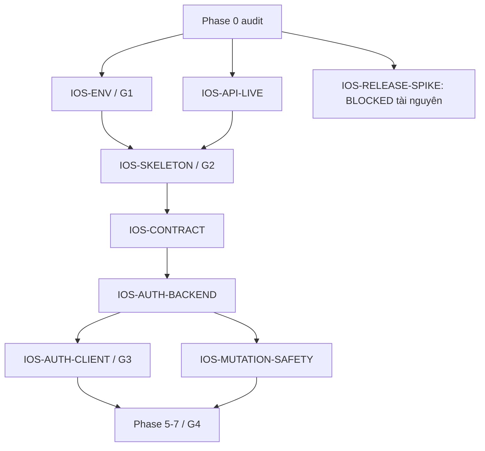

# Backlog sau audit Phase 0

Đây là issue drafts trong repo; chưa tạo issue/label trên GitHub. Nhãn đề xuất: `ios`, `phase:0`…`phase:13`, `backend`, `security`, `blocking`, `release`, `testing`, `P0`, `P1`, `P2`.

| Draft | Priority | Scope / kết quả | Phụ thuộc | Acceptance |
|---|---|---|---|---|
| IOS-ENV | P0 | IOS-0101…0134: Ubuntu dev, Swift/SDK/xtool, USB và hello-world | iPhone/cáp đã có; model/iOS + Apple ID setup | G1: build/install/open/edit/redeploy evidence |
| IOS-API-LIVE | P0 | IOS-0003…0007: DB riêng, health + Swagger + fixtures thật | URL test/staging được xác minh | Không PII/token; database up; status/body matches |
| IOS-AUTH-BASELINE-TEST | P1 | Sửa expectation login lastActiveAt | Không | 47 unit tests pass; không đổi runtime chỉ để chiều test |
| IOS-SKELETON | P0 | IOS-0201…0218: template, configuration, health view | IOS-ENV, IOS-API-LIVE | G2 trên iPhone; loading/error thực |
| IOS-CONTRACT | P0 | IOS-0301…0330: Codable, mappers, transport | IOS-SKELETON + fixture baseline | Null/date/status/error fixtures; Swift tests thích hợp |
| IOS-AUTH-BACKEND | P0 | IOS-0401…0418: native endpoints, effective auth, atomic refresh, disabled access | Contract + ADR-002 | Web/native regression + refresh race + no-store |
| IOS-AUTH-CLIENT | P0 | IOS-0419…0434: Keychain, SessionActor | IOS-AUTH-BACKEND, IOS-CONTRACT | Single-flight, late refresh after logout, Keychain failure, G3 |
| IOS-TIME-CONTRACT | P1 | Chốt UTC/UTC+7 và repeated streak-freeze behavior | Audit source | Backend boundary/regression tests; explicit semantics |
| IOS-MUTATION-SAFETY | P0 trước G4 | Review/quiz idempotency hoặc atomic state policy | IOS-AUTH-BACKEND | Timeout/parallel requests không double-apply |
| IOS-RELEASE-SPIKE | P0 release, BLOCKED | IOS-0020…0028 / 1201…1227 | ADP + distribution build resource chưa có | Archive/export/processing/TestFlight evidence |

Không cần chờ release unblock để làm G1 theo phạm vi thiết bị cá nhân đã chọn. Không bật workflow macOS hoặc mua membership trong scope hiện tại. Các fix backend nằm ở issue riêng; thay đổi Phase 0 chỉ là tài liệu và công cụ audit.
